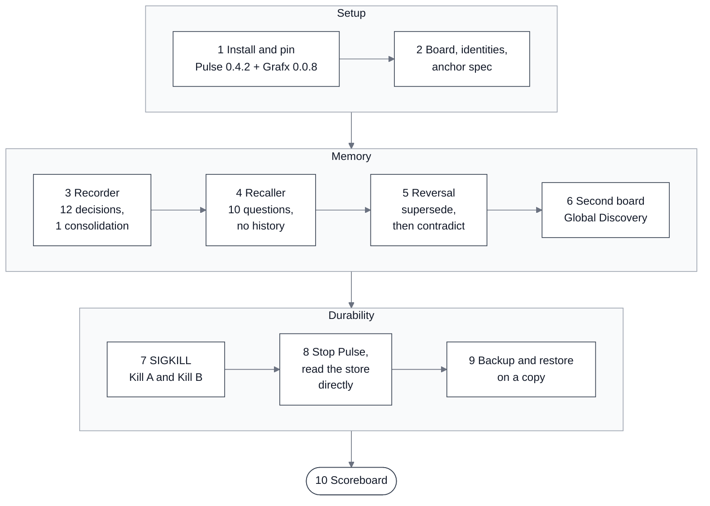

# Pulse + Grafx Decision Memory Demo


Three Claude Code sessions. One shared memory. A decision graph that survives a SIGKILL.

A team plans changes to a blogging API. Every decision is recorded once on an Okto Pulse board, stored in Okto Grafx, then recalled by a session with no history, reversed, crashed, and read straight from disk.

[About](#about-okto-pulse-and-grafx) · [The Problem](#the-problem) · [How It Works](#how-it-works) · [Pulse in Action](#pulse-in-action) · [Architecture](#architecture) · [Repository Structure](#repository-structure) · [The Demo App](#the-demo-app) · [Roles](#roles) · [Prerequisites](#prerequisites) · [Quickstart](#quickstart) · [The Ten Steps](#the-ten-steps) · [Where to Find Artifacts](#where-to-find-artifacts) · [Limits](#limits) · [Licenses](#licenses)

## About Okto Pulse and Grafx

[Okto Pulse](https://github.com/OktoLabsAI/okto-pulse) is a local-first SDLC workbench for teams using AI coding agents. Agents talk to it over MCP, and people see the same board in a web UI. [Okto Grafx](https://github.com/OktoLabsAI/okto-grafx) is the graph store underneath: each board keeps its knowledge graph in a Grafx store on disk.

In plain terms, a decision is not a line in a chat that disappears. It becomes a node with a file and a line behind it, linked to the decisions it supersedes, contradicts or depends on.

## The Problem

Coding agents forget. A new session starts blank, and a decision made last week is either re-argued or silently broken. This repo tests three things directly, on a real run, instead of describing them:

- **Recall without history.** Can a fresh session answer "what did we decide about X" from the graph alone, with no chat history and no file access?
- **Reversal.** When a decision is reversed, does the graph keep the old one, mark it superseded, and record the contradiction, instead of overwriting it?
- **Durability.** After the server is killed, are the acknowledged decisions still there, and can they be read from the file with Pulse stopped?

The recorded outputs of the real run, not claims, are in [`docs/SCOREBOARD.md`](docs/SCOREBOARD.md). Surprises and limits are in [`docs/FINDINGS.md`](docs/FINDINGS.md).

## How It Works

A team plans changes to a blogging API (a plain copy of [`fastapi-realworld-example-app`](https://github.com/nsidnev/fastapi-realworld-example-app), never run). Three sessions share only the board graph. Nobody remembers anybody else.

1. **Record.** The Recorder reads the code and commits twelve decisions in one consolidation, each with a file and line that exist.
2. **Recall.** The Recaller starts with no history and answers ten fixed questions from the graph.
3. **Reverse.** The Maintainer reverses a decision. The Reviewer records the new one as superseding the old, with an explicit `contradicts` edge.
4. **Discover.** A second board finds a convention on the first through Global Discovery.
5. **Crash.** The server is killed with SIGKILL twice: once with an open session, once in the middle of a commit burst.
6. **Read the file.** Pulse is stopped, and the stores are read directly with `oktografx` and a read-only reader.
7. **Restore.** The store is backed up and restored on a copy, then checked with `verify`.

## Pulse in Action

Real captures from this run.

**Step 3**: the decision board in Pulse's graph view, "Powered by Okto Grafx":


**Step 5**: the reversal, a new decision with an explicit `contradicts` edge:


**Step 6**: Global Discovery finds a convention on another board:


## Architecture

Three Claude Code sessions use Okto Pulse over MCP. Pulse keeps each board graph in an Okto Grafx store on disk, and outside tools read the stopped store.




**Reading the flow**

1. **Setup**: install the pinned versions, create the board, four identities and the anchor spec.
2. **Memory**: record twelve decisions, recall them with no history, reverse one, then find another board's convention.
3. **Durability**: kill the server, stop it, read the store directly, back up and restore a copy.
4. **Scoreboard**: every number comes from the recorded outputs of the steps above. See [`docs/SCOREBOARD.md`](docs/SCOREBOARD.md).

More diagrams (sequence, reversal, crash and backup): [`docs/how-it-works.md`](docs/how-it-works.md).

## Repository Structure

```text
pulse-grafx-decision-memory-demo/
├── README.md
├── LICENSE                     # demo code, MIT
├── run_demo.py                 # replay any steps: --steps, --start, --dry-run
├── requirements.txt            # pinned okto-pulse 0.4.2 and okto-grafx 0.0.8
├── requirements-dev.txt        # test dependencies
├── app/                        # the demo app: a read-only copy of a blogging API
│   ├── FORK_NOTES.md
│   ├── LICENSE                 # its own MIT license
│   └── app/                    # FastAPI source the agents read
├── agents/                     # one folder per role
│   ├── recorder/CLAUDE.md
│   ├── recaller/CLAUDE.md
│   ├── reviewer/CLAUDE.md
│   └── mcp.*.example.json      # MCP configs with key placeholders
├── scripts/                    # start, stop, kill, one script per step
│   ├── step03_recorder.py ... step09_backup_restore.py
│   └── check_citations.py, read_store_counts.py, run_agent.py,
│       build_closeout.py, render_scoreboard.py
├── demo-state/                 # every recorded output of the real run
│   ├── step1/ ... step9/
│   ├── notes/
│   ├── screenshots/
│   └── closeout-result.json
├── docs/
│   ├── walkthrough.md
│   ├── SCOREBOARD.md
│   ├── FINDINGS.md
│   ├── VERIFIED.md
│   ├── how-it-works.md
│   ├── prompts/                # the prompt for each agent step
│   ├── hero.svg
│   └── architecture.svg
├── tests/                      # tests that read the recorded outputs
└── .github/workflows/validate.yml
```

## The Demo App

`app/` is the codebase the three sessions plan changes for: a plain copy of [`nsidnev/fastapi-realworld-example-app`](https://github.com/nsidnev/fastapi-realworld-example-app), a blogging API (users, articles, comments, tags) built with FastAPI.

It is never run, so Postgres is not needed. The Recorder only reads it, and every decision it records points at a real file and line in it, which the citation checker confirms. The scenario around it (who decided what, and why the reversal happens) is invented for the demo. See [`app/FORK_NOTES.md`](app/FORK_NOTES.md).

## Roles

Pulse enforces roles through permission presets, not instructions an agent could ignore.

| Who | Does | Pulse preset |
| --- | ---- | ------------ |
| Recorder | Reads the code, records twelve decisions in one consolidation | `Spec` |
| Recaller | No history, no file access, answers ten questions from the graph | `Reporter` (read only) |
| Reviewer | Records a reversed decision, reads contradictions and the supersedence chain | `Validator` |
| Maintainer | Scripts, SIGKILL, stopping the server | `Full Control` |

Each session is a separate headless `claude -p` process with its own MCP config and no saved history. The Recaller really is read only: at the end of its run it tries to open a write session and Pulse refuses with `permission_denied`.

## Prerequisites

| Requirement | Notes |
| ----------- | ----- |
| Mac or Linux | Step 7 uses SIGKILL. Windows is not covered. |
| Python 3.11 to 3.13 | Grafx does not list 3.14. |
| [Claude Code](https://docs.claude.com/en/docs/claude-code), logged in | No other model key is needed. |
| Network to PyPI, GitHub, Hugging Face | Pulse downloads its embedding model on first start. |
| Ports 8100 and 8101 free | |
| Docker (macOS only) | Grafx 0.0.8 refuses backups on macOS, so step 9 runs in a Linux container. |

## Quickstart

```bash
python run_demo.py --dry-run        # prints every command and prompt, runs nothing
python run_demo.py --steps 1 2 3    # install, start, board, Recorder
python run_demo.py --start 4        # or run everything from step 4 on
```

A real run uses a throwaway Pulse data home at `.work/pulse-home` and never touches `~/.okto-pulse`. Checks without a Pulse install:

```bash
pip install -r requirements-dev.txt && python -m pytest tests -q
```

## The Ten Steps

| # | What happens | Output |
|---|---|---|
| 1 | Install the pinned Pulse, confirm it pulls Grafx 0.0.8, init, start, check the embedding model | [`step1`](demo-state/step1/) |
| 2 | Board, four identities from Pulse presets, anchor spec | [`step2`](demo-state/step2/) |
| 3 | Recorder commits twelve decisions, each with a file and line that exist | [`step3`](demo-state/step3/) |
| 4 | Recaller answers ten fixed questions with no history | [`step4`](demo-state/step4/) |
| 5 | Maintainer reverses a decision, Reviewer records it | [`step5`](demo-state/step5/) |
| 6 | Second board, Global Discovery from the first | [`step6`](demo-state/step6/) |
| 7 | SIGKILL the server twice (open session, then a commit burst) | [`step7`](demo-state/step7/) |
| 8 | Stop Pulse, read the stores with `oktografx` and a read-only reader | [`step8`](demo-state/step8/) |
| 9 | Back up and restore a copy, then `verify` | [`step9`](demo-state/step9/) |
| 10 | Build the scoreboard | [`closeout-result.json`](demo-state/closeout-result.json) |

## Where to Find Artifacts

- `demo-state/closeout-result.json`: the machine-readable result of the run. Everything in the scoreboard is generated from it.
- `docs/SCOREBOARD.md`: results, recall question by question, time per step.
- `docs/FINDINGS.md`: what behaved differently from the docs, and the full limits.
- `docs/walkthrough.md`: commands and what to look at, step by step.
- `docs/prompts/`: the actual prompt for each agent step.
- `docs/VERIFIED.md`: what was checked and when.

## Limits

> [!IMPORTANT]
> Pre-alpha Grafx and a 0.x Pulse, one run on one machine, a SIGKILL crash only (macOS, not power loss, not Windows), reads taken with Pulse stopped, backup run in a Linux container because Grafx 0.0.8 refuses it on macOS. Both products are source-available, not open source. [All limits](docs/FINDINGS.md#limits).

## Licenses

To reproduce the run, fork this repo and follow the [walkthrough](docs/walkthrough.md).

| Part | License |
| ---- | ------- |
| Demo code in this repo | [MIT](LICENSE) |
| `app/` (the demo app) | [MIT](app/LICENSE), kept from the original project |
| [Okto Pulse](https://github.com/OktoLabsAI/okto-pulse) | [Elastic License 2.0](https://github.com/OktoLabsAI/okto-pulse/blob/main/LICENSE) |
| [Okto Grafx](https://github.com/OktoLabsAI/okto-grafx) | [Elastic License 2.0 with SaaS/Branding Addendum](https://github.com/OktoLabsAI/okto-grafx/blob/main/LICENSE) |

Pulse and Grafx are installed from PyPI at pinned versions. Their source is not included in this repo.
