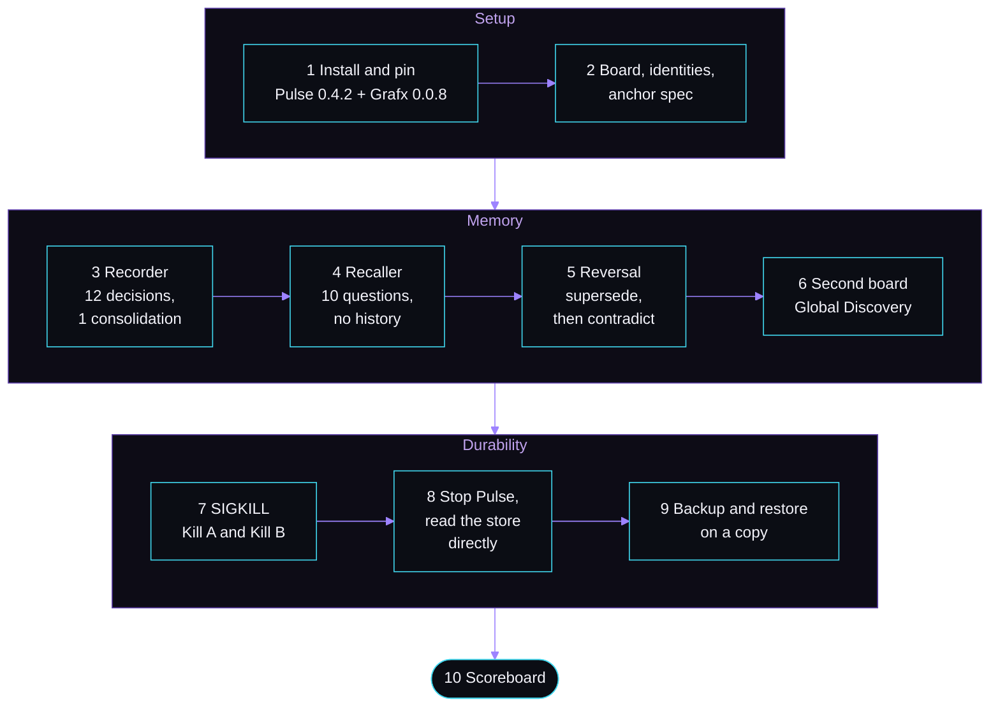

<p align="center">
  
</p>

<p align="center">
  <a href="https://pypi.org/project/okto-pulse/"></a>
  <a href="https://pypi.org/project/okto-grafx/"></a>
  
  
  
</p>

<h1 align="center">pulse-grafx-decision-memory-demo</h1>

<p align="center">
  Three Claude Code sessions share one memory: the knowledge graph on an <a href="https://github.com/OktoLabsAI/okto-pulse">Okto Pulse</a> board, stored in <a href="https://github.com/OktoLabsAI/okto-grafx">Okto Grafx</a>.<br>
  Then the server is killed, restarted, stopped, and the graph is read straight from disk.
</p>

---

## Results

One real run on one machine. The numbers are generated from [`demo-state/closeout-result.json`](demo-state/closeout-result.json).

<!-- glance:start -->
<table>
<tr><td align="center" width="33%"><h2>12 / 12</h2><sub>decisions committed in one consolidation, each with a file and line that exist</sub></td><td align="center" width="33%"><h2>10 / 10</h2><sub>questions answered with the right decision by a session that had no history</sub></td><td align="center" width="33%"><h2>20 / 20</h2><sub>acknowledged commits still in the graph after a SIGKILL and restart</sub></td></tr>
<tr><td align="center" width="33%"><h2>absent</h2><sub>the unfinished consolidation after the same kind of kill (Kill A)</sub></td><td align="center" width="33%"><h2>match</h2><sub>node and edge counts read straight from the stopped store, against Pulse's own</sub></td><td align="center" width="33%"><h2>clean</h2><sub><code>verify</code> on the restored copy (0 findings)</sub></td></tr>
</table>
<!-- glance:end -->

Full tables: [scoreboard](docs/SCOREBOARD.md) · surprises and limits: [findings](docs/FINDINGS.md)

> [!IMPORTANT]
> Pre-alpha Grafx and a 0.x Pulse, one run on one machine, a SIGKILL crash only (macOS, not power loss, not Windows), reads taken with Pulse stopped, backup run in a Linux container because Grafx 0.0.8 refuses it on macOS. Both products are source-available, not open source. [All limits](docs/FINDINGS.md#limits).

## How it works

A team plans changes to a blogging API (a plain copy of [`fastapi-realworld-example-app`](https://github.com/nsidnev/fastapi-realworld-example-app), never run). Three sessions share only the board graph. Nobody remembers anybody else.



| Who | Does | Pulse preset |
|---|---|---|
| Recorder | Reads the code, records twelve decisions in one consolidation | `Spec` |
| Recaller | No history, no file access, answers ten questions from the graph | `Reporter` (read only) |
| Reviewer | Records a reversed decision, reads contradictions and the supersedence chain | `Validator` |
| Maintainer | Scripts, SIGKILL, stopping the server | `Full Control` |

More: [how it works](docs/how-it-works.md) (sequence, reversal, crash and backup diagrams, repo layout, prerequisites).

<p align="center">
  
</p>

## In action

<table>
  <tr>
    <td width="33%"><br><sub><b>Step 3.</b> The decision board in Pulse's graph view, "Powered by Okto Grafx".</sub></td>
    <td width="33%"><br><sub><b>Step 5.</b> The reversal: new decision, explicit <code>contradicts</code> edge.</sub></td>
    <td width="33%"><br><sub><b>Step 6.</b> Global Discovery finds a convention on another board.</sub></td>
  </tr>
</table>

## Quickstart

Needs Mac or Linux, Python 3.11 to 3.13, [Claude Code](https://docs.claude.com/en/docs/claude-code) logged in, network access, and ports 8100 and 8101 free.

```bash
python run_demo.py --dry-run        # prints every command and prompt, runs nothing
python run_demo.py --steps 1 2 3    # install, start, board, Recorder
python run_demo.py --start 4        # or run everything from step 4 on
```

A real run uses a throwaway Pulse data home at `.work/pulse-home` and never touches `~/.okto-pulse`. Checks without a Pulse install: `pip install -r requirements-dev.txt && python -m pytest tests -q`.

## The ten steps

| # | What happens | Output |
|---|---|---|
| 1 | Install the pinned Pulse, confirm it pulls Grafx 0.0.8, init, start, check the embedding model | [`step1`](demo-state/step1/) |
| 2 | Board, four identities from Pulse presets, anchor spec | [`step2`](demo-state/step2/) |
| 3 | Recorder commits twelve decisions, each with a file and line that exist | [`step3`](demo-state/step3/) |
| 4 | Recaller answers ten fixed questions with no history | [`step4`](demo-state/step4/) |
| 5 | Maintainer reverses a decision, Reviewer records it | [`step5`](demo-state/step5/) |
| 6 | Second board, Global Discovery from the first | [`step6`](demo-state/step6/) |
| 7 | SIGKILL the server twice (open session, then a commit burst) | [`step7`](demo-state/step7/) |
| 8 | Stop Pulse, read the stores with `oktografx` and a read-only reader | [`step8`](demo-state/step8/) |
| 9 | Back up and restore a copy, then `verify` | [`step9`](demo-state/step9/) |
| 10 | Build the scoreboard | [`closeout-result.json`](demo-state/closeout-result.json) |

Commands and what to look at: [walkthrough](docs/walkthrough.md). Prompts: [`docs/prompts/`](docs/prompts/). What was checked and when: [VERIFIED.md](docs/VERIFIED.md).

## Licenses

Demo code: [MIT](LICENSE). `app/` keeps its own [MIT license](app/LICENSE). Okto Pulse: [Elastic License 2.0](https://github.com/OktoLabsAI/okto-pulse/blob/main/LICENSE). Okto Grafx: [Elastic License 2.0 with SaaS/Branding Addendum](https://github.com/OktoLabsAI/okto-grafx/blob/main/LICENSE). Linked, not copied.
