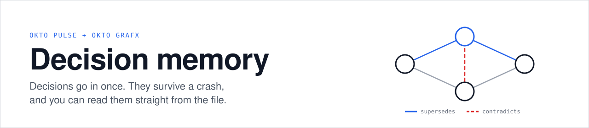
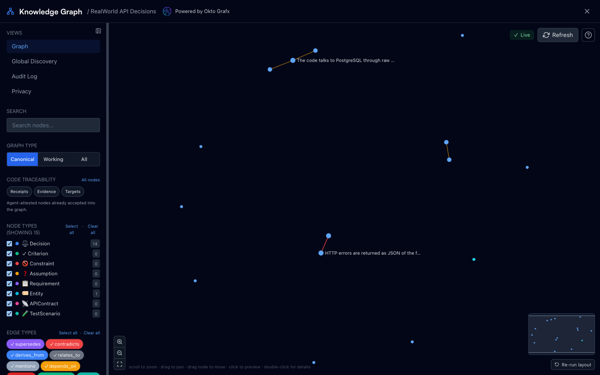
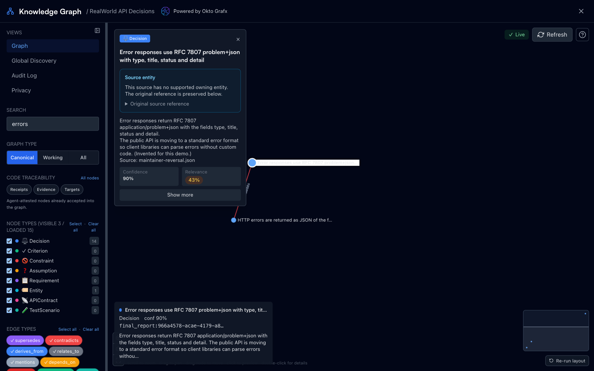
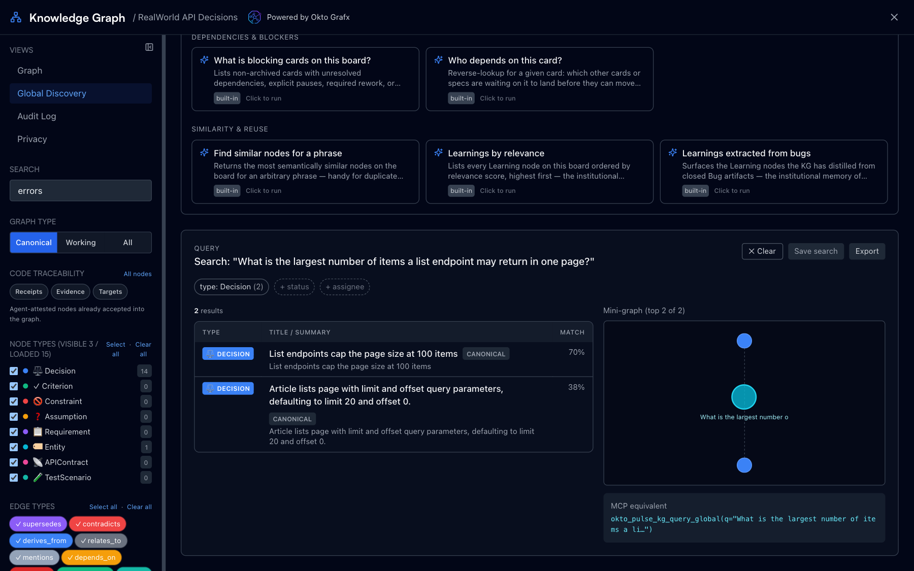
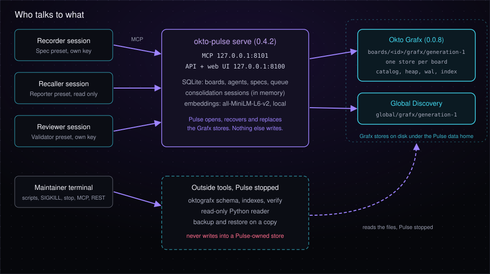
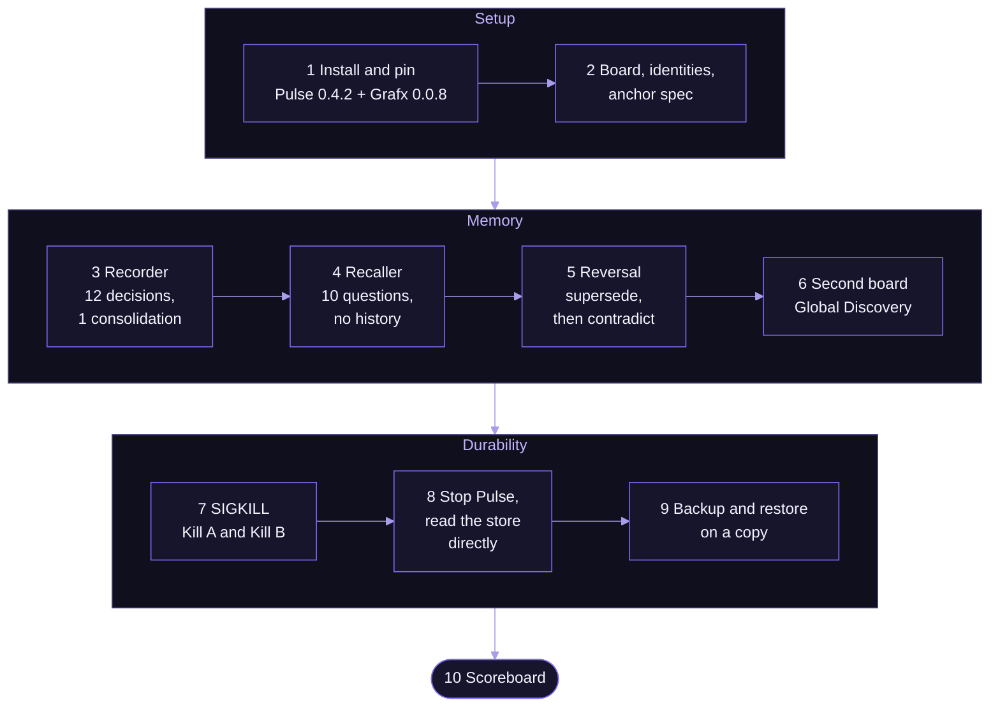

# Pulse + Grafx Decision Memory Demo



Three Claude Code sessions. One shared memory. Acknowledged decision commits that were still there after a SIGKILL of the Pulse server, in four recorded runs: three on macOS and one in a Linux container.

A team plans changes to a blogging API. Every decision is recorded once on an Okto Pulse board, stored in Okto Grafx, then recalled by a session with no history, reversed, crashed, and read straight from disk.

[Scenario](#the-scenario) · [About](#about-okto-pulse-and-grafx) · [The Problem](#the-problem) · [How It Works](#how-it-works) · [Pulse in Action](#pulse-in-action) · [Architecture](#architecture) · [Repository Structure](#repository-structure) · [The Demo App](#the-demo-app) · [Roles](#roles) · [Prerequisites](#prerequisites) · [Quickstart](#quickstart) · [The Ten Steps](#the-ten-steps) · [Where to Find Artifacts](#where-to-find-artifacts) · [Limits](#limits) · [What This Demo Does Not Show](#what-this-demo-does-not-show) · [Licenses](#licenses)

## The Scenario

A small team owns a blogging API. The maintainer decides how errors are shaped, how passwords are hashed and how long a login token lives. Each decision is written down once, with the file and line it applies to, and with the reason when there is one.

Weeks later a new maintainer, or a coding agent in a fresh session, wants to change the error format. It has no chat history. Without a decision record it either re-argues a settled question or breaks an earlier choice without knowing why it was made, and the reason is gone. When the maintainer does reverse a decision, the old one should stay on record as superseded, not be overwritten.

- **Who writes:** the maintainer, or a Recorder session working from the code and the maintainer's notes.
- **Who reads later:** a new session with no history (the Recaller and the Reviewer here), and people looking at the board in the Pulse UI.
- **What breaks without it:** settled questions are re-argued, and reversals leave no trace.

This repo checks that Pulse and Grafx can hold such a record and give it back. It does not measure how much time or how many mistakes that saves a real team. The invented data is listed in [FINDINGS](docs/FINDINGS.md#limits).

## About Okto Pulse and Grafx

[Okto Pulse](https://github.com/OktoLabsAI/okto-pulse) is a local-first SDLC workbench for teams using AI coding agents. Agents talk to it over MCP, and people see the same board in a web UI. [Okto Grafx](https://github.com/OktoLabsAI/okto-grafx) is the graph store underneath: each board keeps its knowledge graph in a Grafx store on disk.

In plain terms, a decision is not a line in a chat that disappears. It becomes a node with a file and a line behind it. A node can be linked to the decisions it supersedes, contradicts or depends on. Who made which link, in the recorded run 1 (prompts in [`docs/prompts/recorded-run-1/`](docs/prompts/recorded-run-1/)):

| Link | Made by | How |
| ---- | ------- | --- |
| Node with file and line | Recorder agent, checked by `check_citations.py` | The recorded prompt listed the 12 decisions to record. The agent found the file and line. |
| `depends_on` (3 edges) | Recorder agent | The prompt allowed up to five edges. The agent chose three. |
| `supersedes` | Pulse, on an override the prompt supplied | The recorded prompt gave the exact `SUPERSEDE` override JSON. Pulse applied it and marked the old node. |
| `contradicts` | The prompt asked for it, the agent added it | Pulse did not flag the reversal by itself ([FINDINGS](docs/FINDINGS.md)). The pair appeared only after the explicit edge. |

Pulse alone flagged 0 contradiction pairs after the `SUPERSEDE`. The `contradicts` edge is a step the agent added because the prompt told it to, not a Pulse feature. With the goal-based Reviewer prompt, which names no edge, 5 of 5 Reviewers on a board that held the old decision added a `contradicts` edge themselves, and only 1 of 5 flagged the old node as superseded ([live runs](docs/SCOREBOARD.md#live-runs-with-a-model)). The full table of what Pulse did and what the script or prompt told it is in [`docs/EVIDENCE-AND-CONTROLS.md`](docs/EVIDENCE-AND-CONTROLS.md#what-pulse-did-and-what-the-script-or-the-prompt-told).

The source references look like `final_report:<spec id>:decision:<slug>`. No final report exists in this demo. In the installed 0.4.2 `okto_pulse/core/kg/connectivity_guard.py` (lines 480 to 513) `final_report:` is listed as a technical-root prefix for Decision nodes written by `commit_consolidation`, so it lets a decision pass the connectivity rule. It is a way past that rule, not a link to real work.

## The Problem

Coding agents forget. A new session starts blank, and a decision made last week is either re-argued or silently broken. This repo tests three things directly, on a real run, instead of describing them:

- **Recall without history.** Can a fresh session answer "what did we decide about X" from the graph alone, with no chat history and no file access?
- **Reversal.** When a decision is reversed, does the graph keep the old one, mark it superseded, and record the contradiction, instead of overwriting it?
- **Durability.** After the server is killed, are the acknowledged decisions still there, and can they be read from the file with Pulse stopped?

The recorded outputs of the real run, not claims, are in [`docs/SCOREBOARD.md`](docs/SCOREBOARD.md). Surprises and limits are in [`docs/FINDINGS.md`](docs/FINDINGS.md).

## How It Works

A team plans changes to a blogging API (a trimmed copy of [`fastapi-realworld-example-app`](https://github.com/nsidnev/fastapi-realworld-example-app), never run). Three sessions share only the board graph. Nobody remembers anybody else.

1. **Record.** The Recorder reads the code and commits twelve decisions in one consolidation, each with a file and line that exist.
2. **Recall.** The Recaller starts with no history and answers ten fixed questions from the graph.
3. **Reverse.** The Maintainer reverses a decision. The Reviewer records the new one as superseding the old, with an explicit `contradicts` edge.
4. **Discover.** A second board finds a convention on the first through Global Discovery.
5. **Crash.** The server is killed with SIGKILL twice: once with an open session, once in the middle of a commit burst.
6. **Read the file.** Pulse is stopped, and the stores are read directly with `oktografx` and a read-only reader.
7. **Restore.** The store is backed up and restored on a copy, then checked with `verify`.

## Pulse in Action

Real captures from this run.

**Step 3**: the decision board in Pulse's graph view, "Powered by Okto Grafx":



**Step 5**: the reversal, a new decision with an explicit `contradicts` edge:



**Step 6**: Global Discovery finds a convention on another board:



## Architecture

Three Claude Code sessions use Okto Pulse over MCP. Pulse keeps each board graph in an Okto Grafx store on disk, and outside tools read the stopped store.





**Reading the flow**

1. **Setup**: install the pinned versions, create the board, four identities and the anchor spec.
2. **Memory**: record twelve decisions, recall them with no history, reverse one, then find another board's convention.
3. **Durability**: kill the server, stop it, read the store directly, back up and restore a copy.
4. **Scoreboard**: every number comes from the recorded outputs of the steps above. See [`docs/SCOREBOARD.md`](docs/SCOREBOARD.md).

More diagrams (sequence, reversal, crash and backup): [`docs/how-it-works.md`](docs/how-it-works.md).

## Repository Structure

```text
pulse-grafx-decision-memory/
├── README.md
├── LICENSE                     # demo code, MIT
├── run_demo.py                 # replay any steps: --steps, --start, --dry-run
├── requirements.txt            # pinned okto-pulse 0.4.2 and okto-grafx 0.0.8
├── constraints.txt             # pins for fastmcp, the embedding libraries and the rest
├── requirements-dev.txt        # test dependencies
├── app/                        # the demo app: a read-only, trimmed copy of a blogging API
│   ├── FORK_NOTES.md
│   ├── LICENSE                 # its own MIT license
│   └── app/                    # FastAPI source the agents read
├── agents/                     # one folder per role
│   ├── recorder/CLAUDE.md
│   ├── recaller/CLAUDE.md
│   ├── reviewer/CLAUDE.md
│   ├── answerer/CLAUDE.md      # the control arms, no Pulse
│   └── mcp.*.example.json      # MCP configs with key placeholders
├── config/agent.json           # the pinned agent model
├── corpus/                     # decisions, questions (one set by a second model) and the reference list the checks use
├── docker/Dockerfile.linux     # the Linux image of the container crash run
├── scripts/                    # start, stop, kill, one script per step, the integration runner
│   ├── step03_recorder.py ... step09_backup_restore.py
│   ├── run_integration.py, assert_runtime.py   # the non-LLM steps, then assertions
│   ├── check_citations.py, read_store_counts.py, run_agent.py,
│   │   build_closeout.py, render_scoreboard.py
│   └── run_n.py, run_arms.py, run_linux_crash.py, export_llm_runs.py   # repeats, arms, Linux crash run, record of live runs
├── demo-state/                 # every recorded output of run 1, and of the runs after it
│   ├── step1/ ... step9/       # run 1
│   ├── llm-runs/<run id>/      # the live model runs: smoke, three studies, manifest
│   ├── arms/                   # arm files, the LLM arms with their transcripts
│   ├── integration-<run id>/   # dated integration run with step 9
│   ├── linux-crash-<run id>/   # the Linux container run
│   ├── notes/
│   ├── screenshots/
│   └── closeout-result.json
├── docs/
│   ├── walkthrough.md
│   ├── SCOREBOARD.md
│   ├── FINDINGS.md
│   ├── PRODUCT-OBSERVATIONS.md # what the demo reports about Pulse and Grafx themselves
│   ├── VERIFIED.md
│   ├── how-it-works.md
│   ├── prompts/                # the prompt for each agent step
│   ├── provenance/             # the plan and prompt this repo was first generated from
│   ├── hero.svg
│   └── architecture.svg
├── tests/                      # tests that read the recorded outputs
└── .github/workflows/
    ├── validate.yml            # fast, offline: recorded files only
    ├── integration.yml         # starts real Pulse and Grafx, no LLM
    ├── llm-steps.yml           # manual: steps 3 to 5 with a model and a secret
    └── links.yml               # weekly: external links
```

## The Demo App

`app/` is the codebase the three sessions plan changes for: a trimmed copy of [`nsidnev/fastapi-realworld-example-app`](https://github.com/nsidnev/fastapi-realworld-example-app), a blogging API (users, articles, comments, tags) built with FastAPI.

It is never run, so Postgres is not needed. The Recorder only reads it, and every decision it records points at a real file and line in it, which the citation checker confirms. The scenario around it (who decided what, and why the reversal happens) is invented for the demo. See [`app/FORK_NOTES.md`](app/FORK_NOTES.md).

## Roles

Pulse enforces roles through permission presets, not instructions an agent could ignore.

| Role | Does | Pulse preset | Prompt |
| ---- | ---- | ------------ | ------ |
| Recorder | Reads the code, records twelve decisions in one consolidation | `Spec` | [`step3-recorder.md`](docs/prompts/step3-recorder.md) |
| Recaller | No history, no file access, answers ten questions from the graph | `Reporter` (read only) | [`step4-recaller.md`](docs/prompts/step4-recaller.md) |
| Reviewer | Records a reversed decision, reads contradictions and the supersedence chain | `Validator` | [`step5-reviewer.md`](docs/prompts/step5-reviewer.md) |
| Maintainer | Scripts, SIGKILL, stopping the server | `Full Control` | none, scripts only |

The prompts are the only instructions the sessions get. The recorded outputs came from the answer-key prompts in [`docs/prompts/recorded-run-1/`](docs/prompts/recorded-run-1/). The prompts in [`docs/prompts/`](docs/prompts/) are goal-based (no slugs, no override JSON, no edge ids) and are linked in the table above. They were run 33 times with a model, see [the live runs](docs/SCOREBOARD.md#live-runs-with-a-model). Placeholders such as `{{BOARD_ID}}` are filled in at run time. Each session is a separate headless `claude -p` process with its own MCP config and no saved history. Role limits were tested in both directions by a scripted probe (no model, Pulse 0.4.2, one run): the Reporter was refused 5 write actions by permission and 5 session-bound tools by session ownership, the Spec preset 4 actions, the Validator 5, and each identity succeeded at its own work. See [roles](docs/EVIDENCE-AND-CONTROLS.md#role-claim-tested-in-both-directions).

## Prerequisites

| Requirement | Notes |
| ----------- | ----- |
| Mac or Linux | Step 7 uses SIGKILL. Windows is not covered. |
| Python 3.11 to 3.13 | Grafx does not list 3.14. |
| [Claude Code](https://docs.claude.com/en/docs/claude-code), logged in | No other model key is needed. |
| Network to PyPI, GitHub, Hugging Face | Pulse downloads its embedding model on first start. |
| Ports 8100 and 8101 free | |
| Docker (macOS only) | Grafx 0.0.8 refuses backups on macOS, so step 9 runs in a Linux container. |

## Quickstart

```bash
python run_demo.py --dry-run        # prints every command and prompt, runs nothing
python run_demo.py --steps 1 2 3    # install, start, board, Recorder
python run_demo.py --start 4        # or run everything from step 4 on
python run_demo.py --steps 3 4 5    # the goal-based Recorder, Recaller and Reviewer with a model (needs Claude Code, costs about $3)
python scripts/run_n.py --runs 5    # the same, five times on fresh data homes, with mean, min and max (see its docstring)
python scripts/run_arms.py --runs 5 # graph, code only, code and notes, after scripts/build_corpus.py
```

A real run uses a throwaway Pulse data home at `.work/pulse-home` and left `~/.okto-pulse` unchanged in a guarded run (a temporary HOME with one sentinel file there: 1 file before, 1 after, [record](demo-state/home-guard/data-dir-claim.json)). The same run created `~/.cache` in HOME, the Hugging Face cache of the embedding model (35 files, about 87 MB). Checks without a Pulse install:

```bash
pip install -r requirements-dev.txt && python -m pytest tests -q
REQUIRE_EVIDENCE=1 python -m pytest tests -q   # missing recorded output fails instead of skipping (what CI does)
```

## The Ten Steps

Every command is in [`scripts/`](scripts/). `python run_demo.py --list` prints the same sequence, and the commands, prompts and what to check for each step are in the [walkthrough](docs/walkthrough.md).

| # | Step | Actor | Command |
|---|------|-------|---------|
| 1 | Install the pinned Pulse, confirm it pulls Grafx 0.0.8, start it, check the embedding model | Maintainer | `start_pulse.sh` |
| 2 | Create the board, four identities from Pulse presets and the anchor spec | Maintainer | `setup_board.py` |
| 3 | Commit twelve decisions, each with a file and line that exist | Recorder | `step03_recorder.py` |
| 4 | Answer ten fixed questions with no history | Recaller | `step04_recaller.py` |
| 5 | Reverse a decision, then record it as superseding the old one | Maintainer, Reviewer | `step05_reversal.py` |
| 6 | Create a second board and find a convention from the first through Global Discovery | Maintainer | `step06_second_board.py` |
| 7 | SIGKILL the server twice: an open session, then a commit burst | Maintainer | `step07_crash.py` |
| 8 | Stop Pulse and read the stores with `oktografx` and a read-only reader | Maintainer | `step08_direct_read.py` |
| 9 | Back up and restore a copy, then run `verify` | Maintainer | `step09_backup_restore.py` |
| 10 | Build the scoreboard from the recorded outputs | Maintainer | `build_closeout.py` |

## Where to Find Artifacts

- `demo-state/closeout-result.json`: the machine-readable result of the run. Everything in the scoreboard is generated from it.
- `docs/SCOREBOARD.md`: results, recall question by question, time per step, the live model runs, the arms side by side, the crash tests of every run.
- `demo-state/llm-runs/<run id>/run-info.json`: manifest of the live model runs (model, versions, commit, cost, SHA-256 of every file).
- `docs/FINDINGS.md`: what behaved differently from the docs, and the full limits.
- `docs/walkthrough.md`: commands and what to look at, step by step.
- `docs/prompts/`: the actual prompt for each agent step.
- `docs/PRODUCT-OBSERVATIONS.md`: what the demo reports about Pulse and Grafx themselves, with pointers to the raw evidence.
- `docs/VERIFIED.md`: what was checked and when.
- `docs/provenance/`: the plan and the prompt this repo was first generated from. Nothing reads them.

## Limits

> [!IMPORTANT]
> Pre-alpha Grafx and a 0.x Pulse, one machine (Apple silicon, Docker Desktop for the Linux runs), one model, five repeats at most, a SIGKILL crash only (macOS and a Linux container, not power loss, not Windows), reads taken with Pulse stopped, backup run in a Linux container because Grafx 0.0.8 refuses it on macOS. Both products are source-available, not open source. [All limits](docs/FINDINGS.md#limits).

## Live or Recorded

Which results come from a test that runs now, and which only from files recorded earlier.

| Result | Source | Re-checked by |
| ------ | ------ | ------------- |
| Scoreboard numbers, the ten recall questions, the 12 citations, the reversal, both SIGKILL tests, the direct read, the restore | **Recorded.** One real run (run 1, 2026-10-29, macOS arm64, `claude-opus-5-5`), committed in `demo-state/`. | `validate` workflow: the tests read the files. It catches edits to them, not a change in Pulse or Grafx. |
| Steps 1, 2, 5 to 9 and the scripted replacement of the agent steps (the same decisions and the reversal as fixed tool calls) | **Live**, on a fresh data home and free ports, no model. Kept: a dated run with step 9 (48 of 48 assertions, `demo-state/integration-*/`), a Linux container run through step 8 (43 of 43, `demo-state/linux-crash-*/`) and the first scripted run (`demo-state/scripted-run/`, step 9 not run). CI output stays in `.work/integration/` and is not committed. | `integration` workflow, with assertions in `scripts/assert_runtime.py`. It fails when Pulse or Grafx return a different outcome. It runs on Linux, so its SIGKILL runs are Linux runs. As of this change it has not run on GitHub: the first run history will show up in the Actions tab. |
| Steps 3 to 5 with a model (recall score, citations the model chose, the reversal the model recorded) | **Recorded**: run 1 (answer-key prompts), and one smoke run, three five-run studies and the LLM arms (five runs each) with the goal-based prompts, 48 sessions in one folder with a manifest: `demo-state/llm-runs/`, `demo-state/arms/`. | `llm-steps` workflow, run by hand with a secret. It records the model and the date. It has not run on GitHub; the recorded runs were made locally. |
| External links | Live, weekly. | `links` workflow. |
| Screenshots | **Recorded** after the run, so they show its final state. | Nothing. |

`REQUIRE_EVIDENCE=1` is set in the `validate` workflow. With it a missing recorded output fails the test. Without it (a fork that has not run every step) the test is skipped.

## What This Demo Does Not Show

- **No measured advantage of the graph over plain notes.** An agent with the graph and an agent with a text file of the same 32 decisions scored the same in five runs each (10 of 10, 11 of 11 and 11 or 12 of 12 against 10, 11 and 12); the code-only agent found none of the 16 graph-only reasons, which exist only in the graph and the notes. The graph was three times dearer per run than the notes ($0.46 against $0.15). The corpus is 32 invented-reason notes that fit in one file, so this says nothing about a large memory. See [the table](docs/SCOREBOARD.md#arms-side-by-side) and [what each result proves](docs/EVIDENCE-AND-CONTROLS.md).
- **One model, a few repeats.** Every model run used `claude-opus-5-5`. The goal-based Recorder covered 7 to 10 of the 22 reference decisions and never wrote the decision that the Maintainer then reverses, so the reversal was exercised with a model only on a board built by the scripted client (5 of 5 Reviewers recorded it, 1 of 5 flagged the old node as superseded). A different model may score differently.
- **A crash in one setup.** Kill A and Kill B ran four times, on a Mac (three runs) and in a Linux container on a Docker Desktop VM on that Mac. The board refused writes for about 300 s after Kill B in three of the four runs. Power loss, disk faults, a bare-metal Linux host and Windows are not covered. Resuming after Kill A and retrying after Kill B exist in the scripted runs only, not in an agent run.
- **No Pulse started on a restored store.** Step 9 restores a copy and runs `verify` on it. Pulse is never started on it.
- **Decisions the code already holds.** Most recorded decisions are facts that can be read from `app/`. The scenario and the reason for the reversal are invented.
- **Pulse as an SDLC product, only in part.** The 10 graph-only decisions of the scripted run go through `okto_pulse_add_decision`, with one gate refused and then passed. The 12 recorded decisions did not. Pulse 0.4.2 has no sprint object, so the spec to sprint to task path in the review does not exist there ([details](docs/EVIDENCE-AND-CONTROLS.md#decisions-through-pulses-own-flow-and-the-gate-review-22)).

## Licenses

To reproduce the run, fork this repo and follow the [walkthrough](docs/walkthrough.md).

| Part | License |
| ---- | ------- |
| Demo code in this repo | [MIT](LICENSE) |
| `app/` (the demo app) | [MIT](app/LICENSE), kept from the original project |
| [Okto Pulse](https://github.com/OktoLabsAI/okto-pulse) | [Elastic License 2.0](https://github.com/OktoLabsAI/okto-pulse/blob/main/LICENSE) |
| [Okto Grafx](https://github.com/OktoLabsAI/okto-grafx) | [Elastic License 2.0 with SaaS/Branding Addendum](https://github.com/OktoLabsAI/okto-grafx/blob/main/LICENSE) |

Pulse and Grafx are installed from PyPI at pinned versions. Their source is not included in this repo.
