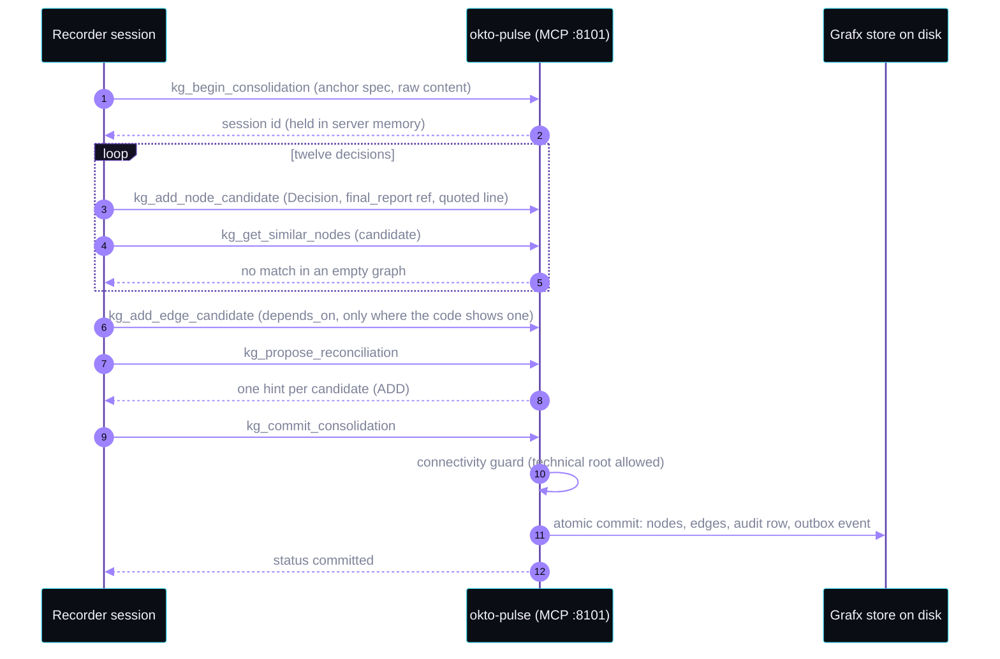
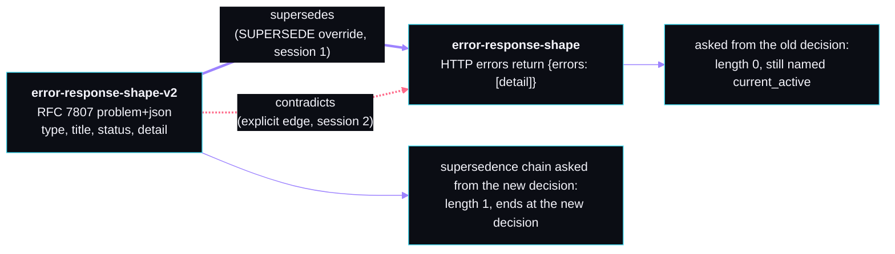
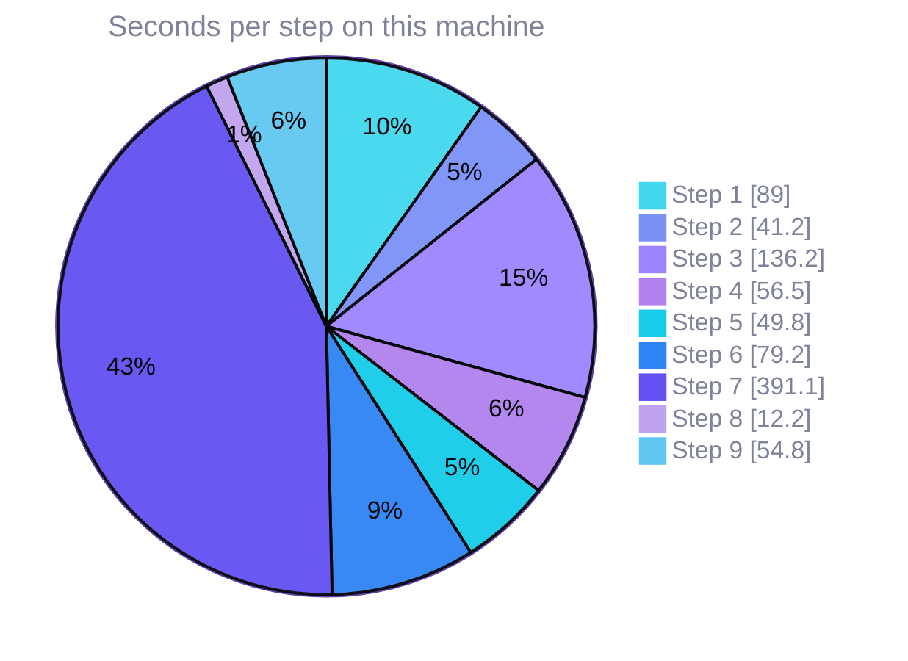
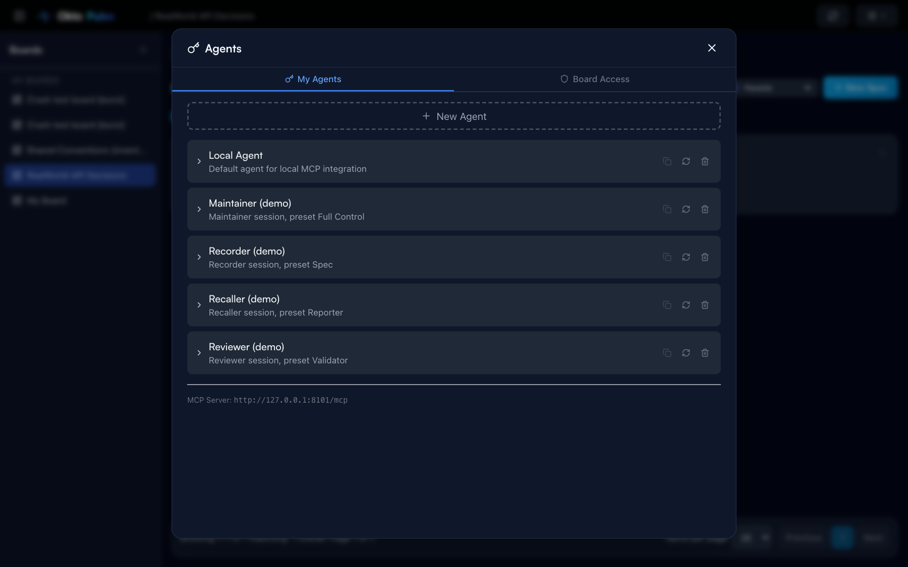
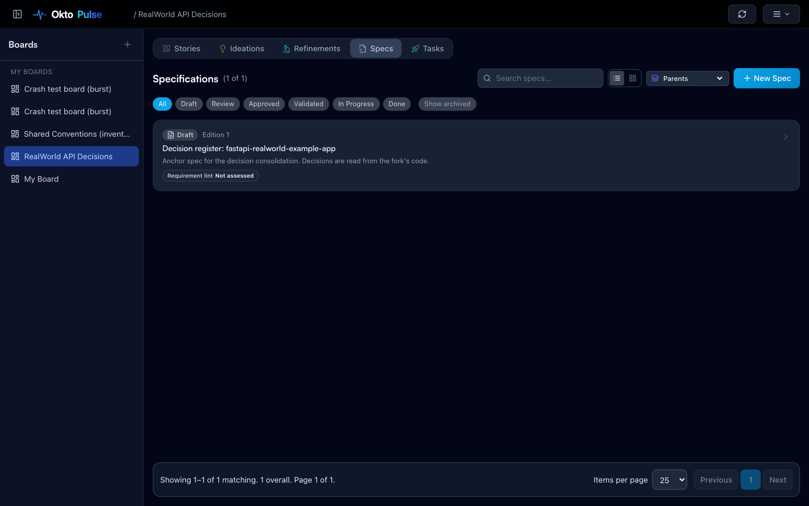
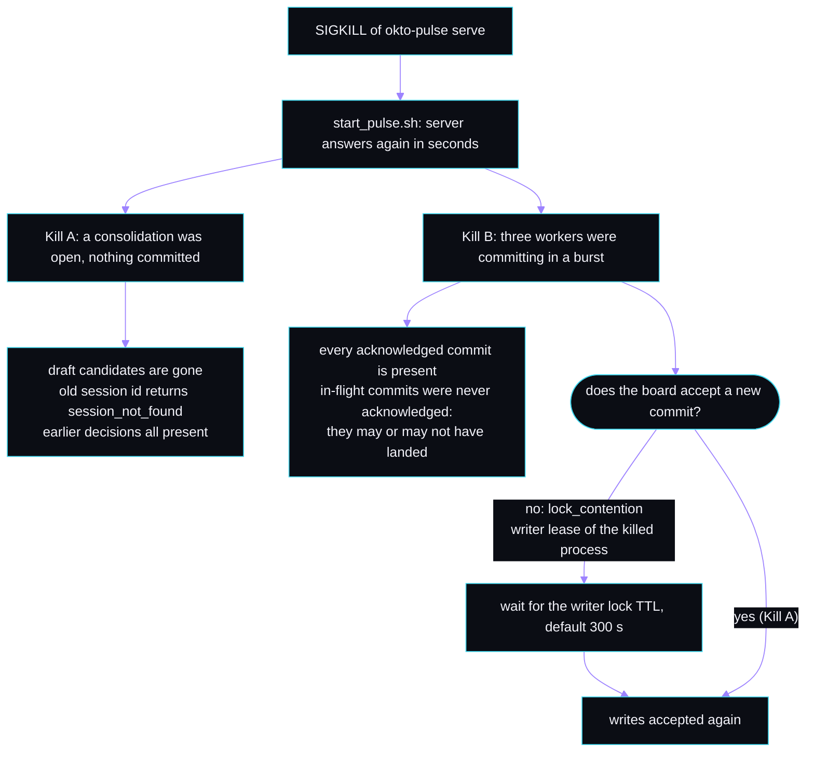
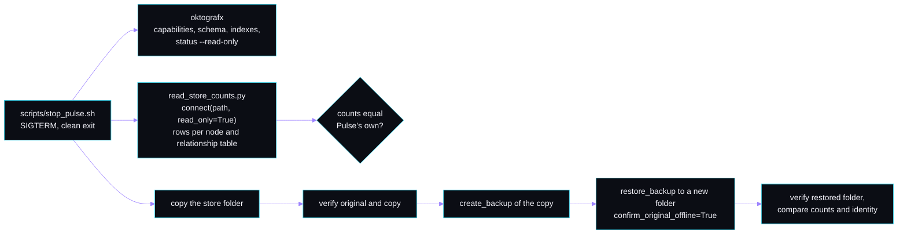

<p align="center">
  
</p>

<p align="center">
  <a href="https://pypi.org/project/okto-pulse/"></a>
  <a href="https://pypi.org/project/okto-grafx/"></a>
  
  
  
  
</p>

<h1 align="center">pulse-grafx-decision-memory-demo</h1>

<p align="center">
  <strong>Three Claude Code sessions share one memory: the knowledge graph on an Okto Pulse board.<br>
  Then the server is killed, restarted, stopped, and the graph is read straight from disk.</strong>
</p>

<p align="center">
  <a href="#at-a-glance">At a glance</a> ·
  <a href="#limits-read-first">Limits</a> ·
  <a href="#how-it-works">How it works</a> ·
  <a href="#pulse-and-grafx-in-action">In action</a> ·
  <a href="#quickstart">Quickstart</a> ·
  <a href="#the-ten-steps">The ten steps</a> ·
  <a href="#things-that-behaved-differently-from-the-docs-or-from-expectation">Findings</a> ·
  <a href="docs/walkthrough.md">Walkthrough</a> ·
  <a href="docs/VERIFIED.md">Verified</a>
</p>

---

## At a glance

Every number in this README comes from one real run on one machine. It is recorded in [`demo-state/closeout-result.json`](demo-state/closeout-result.json), and the tables below are generated from it.

<!-- glance:start -->
<table>
<tr><td align="center" width="33%"><h2>12 / 12</h2><sub>decisions committed in one consolidation, each with a file and line that exist</sub></td><td align="center" width="33%"><h2>10 / 10</h2><sub>questions answered with the right decision by a session that had no history</sub></td><td align="center" width="33%"><h2>20 / 20</h2><sub>acknowledged commits still in the graph after a SIGKILL and restart</sub></td></tr>
<tr><td align="center" width="33%"><h2>absent</h2><sub>the unfinished consolidation after the same kind of kill (Kill A)</sub></td><td align="center" width="33%"><h2>match</h2><sub>node and edge counts read straight from the stopped store, against Pulse's own</sub></td><td align="center" width="33%"><h2>clean</h2><sub><code>verify</code> on the restored copy (0 findings)</sub></td></tr>
</table>
<!-- glance:end -->

> [!NOTE]
> This is a test of what Okto Pulse 0.4.2 and Okto Grafx 0.0.8 do when used this way. It found things that match the docs and things that do not. Both are in [the findings](#things-that-behaved-differently-from-the-docs-or-from-expectation).

## Limits, read first

> [!IMPORTANT]
> - **Pre-release software.** Grafx is pre-alpha and Pulse is a 0.x line. This repo pins both and was verified on those versions only: okto-pulse 0.4.2 and okto-grafx 0.0.8, on 2026-10-29.
> - **One run, one machine.** macOS on Apple silicon, Python 3.12, one Claude model. The recall numbers show this setup. They are not a general accuracy claim. The timings are not a speed claim.
> - **The crash is a SIGKILL of the server process.** It does not cover power loss, disk faults or Windows. The kill ran on macOS. Linux was not run.
> - **Reads happen with Pulse stopped.** Grafx read-only opens need a checkpoint-complete store, and a live Pulse owns its handles. The repo does not open a running Pulse's store from outside, and it never writes into a Pulse-owned store.
> - **Backup needs Linux.** Grafx 0.0.8 refused to take a backup on macOS, so that step ran in a Linux container, on a copy of the stopped store.
> - **A killed server can block writes for about five minutes.** After a SIGKILL during commits, the board refused new commits until a writer lease expired. Acknowledged commits were not lost.
> - **Search quality depends on the local embedding model.** It ran `sentence-transformers/all-MiniLM-L6-v2`, not the stub.
> - **Source-available, not open source.** Both products use the Elastic License 2.0 (Grafx adds a SaaS/Branding Addendum). This repo links to their licenses and copies none of their source.
> - **Invented data.** The scenario, the Maintainer's reason for the reversal, and the three shared conventions are invented. The only real code is the fork of `fastapi-realworld-example-app`.
> - **Graph runtime wording.** An older plan note said the Pulse README describes the graph runtime as LadybugDB. The README fetched on 2026-10-29 says Pulse uses Grafx only. This repo describes the installed 0.4.2 package and shows the commands that confirm it.

## About Pulse and Grafx

**Okto Pulse** is a local-first workbench where AI coding agents plan and track work through stories, specs, sprints and tasks. Each board has a knowledge graph that keeps the decisions behind the work. Agents reach it through MCP.

**Okto Grafx** is the embedded graph database that stores that graph. Pulse 0.4.2 requires exactly `okto-grafx[accel]==0.0.8`, so `pip install okto-pulse` brings Grafx with it. In the installed package Grafx is the only graph backend. Each board's graph is a Grafx store in a folder under the Pulse data home. Global Discovery, the graph that spans boards, is a second store.

Pulse owns those stores. It opens them, recovers them and replaces generations. That is why this repo only reads them from outside, with Pulse stopped, and never writes.

| | Okto Pulse | Okto Grafx |
|---|---|---|
| Role here | Workbench, MCP server, owner of the stores | Graph database that holds each board's decisions |
| Version tested | 0.4.2 (`okto-pulse-core` 0.4.2) | 0.0.8, pinned exactly by Pulse |
| Interface used | MCP tools on `:8101`, web UI and REST on `:8100` | `oktografx` CLI and the `okto_grafx` Python API, read-only |
| License | [Elastic License 2.0](https://github.com/OktoLabsAI/okto-pulse/blob/main/LICENSE) | [Elastic License 2.0 with SaaS/Branding Addendum](https://github.com/OktoLabsAI/okto-grafx/blob/main/LICENSE) |

## The Problem

A team plans changes to an existing blogging API. Every design decision should be kept where any later agent session can find it. Teams ask four things before they trust agent memory:

| Question | Where this repo answers it |
|---|---|
| Will it still be there tomorrow? | Step 7: SIGKILL, restart, compare acknowledged commits with the graph |
| Can a new session find it? | Step 4: a session with no history answers ten fixed questions |
| What happens if the process dies? | Step 7: an unfinished consolidation is discarded, committed ones stay |
| Can I look at it without the app? | Steps 8 and 9: read the stopped store, back it up, restore it, `verify` it |

## How It Works

The codebase is a plain copy of [`nsidnev/fastapi-realworld-example-app`](https://github.com/nsidnev/fastapi-realworld-example-app) in [`app/`](app/). It is never run, so Postgres is not needed. Agents only read it.


### The cast

| Who | Does | Pulse identity |
|---|---|---|
| **Recorder** (session) | Reads the code and records twelve decisions in one consolidation | Preset `Spec`, own key |
| **Recaller** (session) | Starts with no history and answers ten questions from the graph | Preset `Reporter`, read only, own key |
| **Reviewer** (session) | Records a reversed decision, reads contradictions and the supersedence chain | Preset `Validator`, own key |
| **Maintainer** (terminal) | Runs the scripts, reverses a decision, kills and stops the server | Preset `Full Control`, used by scripts only |

Each session is a separate headless `claude -p` process with its own MCP config, `--strict-mcp-config`, and no saved history. Keys are passed through environment variables and kept in `agents/.keys.local`, which git ignores. A scanner checks the repo for keys before every commit.

The sessions get their powers from Pulse's own permission presets. The Recaller really is read only: at the end of its run it tries to open a write session and Pulse refuses with `permission_denied` for `kg.session.begin`.

### How a decision gets in

One consolidation holds all twelve decisions. The session lives in server memory until the commit, which is why a kill before the commit discards it.



A cognitive `Decision` has to be anchored to something. The connectivity guard refused refs of the form `spec:<id>:decision:<slug>` with `kg_node_connectivity_violation`, because the required `belongs_to` edge is reserved for Pulse's deterministic worker. The documented technical root is a source ref that starts with `final_report:`. The demo uses `final_report:<spec-id>:decision:<slug>`. The anchor spec stays in draft.

### What a recorded decision looks like

This is the password decision as read back from the graph ([`decisions-from-graph.json`](demo-state/step3/decisions-from-graph.json)):

```json
{
  "title": "Passwords are hashed with bcrypt through passlib CryptContext, with a per-user bcrypt salt prepended to the password.",
  "content": "security.py builds a passlib CryptContext with schemes [\"bcrypt\"] and deprecated=\"auto\". ... \nSource: app/app/services/security.py:4",
  "ref": "final_report:<spec-id>:decision:password-hashing",
  "quote": "pwd_context = CryptContext(schemes=[\"bcrypt\"], deprecated=\"auto\")",
  "layer": "canonical"
}
```

[`scripts/check_citations.py`](scripts/check_citations.py) opens every cited file, checks that the line exists, and checks that the quote is on it.

**The twelve decisions:** auth header scheme, token expiry, password hashing, error response shape, pagination parameters, slug rules, comment ownership, favorites, tag handling, database access layer, settings loading, test layout.

### The reversal

The Maintainer writes a note that reverses the error response shape. The Reviewer records the new decision with a `SUPERSEDE` override, checks whether Pulse flagged a contradiction, and then adds one explicitly in a second session.



Pulse did not flag the reversal as a contradiction by itself. The pair showed up only after the explicit edge. The numbers are in the scoreboard.

## Pulse and Grafx in Action

### Scoreboard

Generated by [`scripts/render_scoreboard.py`](scripts/render_scoreboard.py) from the recorded outputs. A test fails if the README drifts from them.

<!-- scoreboard:start -->
| Item | Result |
|---|---|
| Pulse and Grafx versions | okto-pulse 0.4.2, okto-pulse-core 0.4.2, okto-grafx 0.0.8 |
| Installed Pulse pins the installed Grafx | yes (`Requires-Dist: okto-grafx[accel]==0.0.8`) |
| Embedding model | sentence-transformers/all-MiniLM-L6-v2 (real model, not the stub) |
| Decisions committed in one consolidation | 12 of 12 |
| Cited file and line that exist | 12 of 12 |
| Recall: right decision chosen by the Recaller | 10 of 10 |
| Recall: right decision ranked first, similarity search | 10 of 10 |
| Recall: right decision ranked first, natural-language search | 10 of 10 |
| Recall: right decision ranked first, decision history | 0 of 10 (the tool returned no decisions for sentence-length topics) |
| Contradiction pairs: before, after supersede only, after explicit flag | 0, 0, 1 |
| Pulse flagged the reversal as a contradiction by itself | no |
| Supersedence chain length from the new decision | 1 (queried from the old decision: 0) |
| Global Discovery: expected convention found on the other board | 2 of 2; waits 5.5 s, 0.3 s |
| Kill A: uncommitted consolidation absent after restart | yes |
| Kill A: earlier decisions still present | yes (13 before, 13 after) |
| Kill A: board accepted a new commit | 19.4 s after the kill |
| Kill B: commits acknowledged before the kill | 20 |
| Kill B: acknowledged commits present after restart | 20 of 20 (0 missing) |
| Kill B: commits in flight at the kill, and how many survived | 2 in flight, 0 survived |
| Kill B: board accepted a new commit | 310.6 s after the kill (refusal while waiting: `lock_contention`; writer lock default TTL 300 s) |
| Health right after the Kill A restart, as returned | graph_state `at_risk`, overall_state `at_risk`, dead letters 0 |
| Health right after the Kill B restart, as returned | graph_state `healthy`, overall_state `healthy`, dead letters 0 |
| Node counts, decision board: Pulse vs direct read | 1 BoardMeta, 14 Decision, 2 Entity vs 1 BoardMeta, 14 Decision, 2 Entity; match: yes; edges 3 depends_on__Decision__Decision, 1 supersedes__Decision__Decision, 1 contradicts__Decision__Decision, 1 belongs_to__Entity__Entity |
| Node counts, crash test board: Pulse vs direct read | 1 BoardMeta, 21 Decision, 2 Entity vs 1 BoardMeta, 21 Decision, 2 Entity; match: yes; edges 1 belongs_to__Entity__Entity |
| Read-only open refused | no |
| Data files unchanged by the direct read | yes |
| `verify` on the stopped store | clean, 0 findings (14046 pages, 33 records, 108 index entries) |
| `verify` on the restored copy | clean, 0 findings (14046 pages, 33 records, 108 index entries) |
| Backup and restore on Linux aarch64 | backup ok, restore ok, counts match: yes, same database identity: yes |
| Backup on Darwin arm64 | refused by Grafx: `This platform has no supported atomic no-replace directory publication. [code=unsupported_operation retryable=False]` |
<!-- scoreboard:end -->

The decision board ends with 14 decisions: the 12 the Recorder committed, the 1 the Reviewer committed, and 1 synthetic `Write probe 1` commit made by the Kill A write check. The crash-test board holds the Kill B commits plus its own write-probe commits. The first Kill B attempt left a second crash-test board in the Pulse data home. The scoreboard uses the later run.

### Recall, question by question

The ten questions were fixed before the first run and were not changed after seeing results. The Recaller had no history and no file access. Scores are computed from the raw tool results in the transcript, not from what the agent said. The number in brackets is the similarity score of the top result.

<!-- recall:start -->
| # | Question | Expected decision | Similarity top 1 | Natural-language top 1 | History | Recaller chose |
|---:|---|---|---|---|---|---|
| 1 | How do clients send their login token on each request, and what prefix does the server expect? | `auth-header-scheme` | yes (0.44) | yes (0.44) | 0 results | right |
| 2 | How long does a login token stay valid before it expires? | `token-expiry` | yes (0.54) | yes (0.54) | 0 results | right |
| 3 | What does the app use to store user passwords safely? | `password-hashing` | yes (0.56) | yes (0.56) | 0 results | right |
| 4 | What does the body of an error response look like when a request fails? | `error-response-shape` | yes (0.56) | yes (0.56) | 0 results | right |
| 5 | Which query parameters control paging through a list of articles? | `pagination-parameters` | yes (0.52) | yes (0.52) | 0 results | right |
| 6 | How is the URL-friendly name of an article produced? | `slug-rules` | yes (0.49) | yes (0.49) | 0 results | right |
| 7 | Who is allowed to delete a comment? | `comment-ownership` | yes (0.67) | yes (0.67) | 0 results | right |
| 8 | What happens when a user marks an article as a favourite? | `favorites` | yes (0.61) | yes (0.61) | 0 results | right |
| 9 | Where does the app keep its settings and how are they read? | `settings-loading` | yes (0.55) | yes (0.55) | 0 results | right |
| 10 | How are the automated tests laid out? | `test-layout` | yes (0.36) | yes (0.36) | 0 results | right |
<!-- recall:end -->

The Recaller chose the similarity tool for all ten questions. The decision-history tool returned nothing for sentence-length topics.

### Time per step

Step 7 is dominated by the wait for the writer lease to expire after Kill B.

<!-- timings:start -->

<!-- timings:end -->

### Screenshots

Taken after the run, so they show its final state (14 decisions on the decision board). No keys or personal paths appear in them.

<table>
  <tr>
    <td width="50%"><br><sub><b>Step 3.</b> The decision board in Pulse's knowledge graph view, "Powered by Okto Grafx". The red link is the contradiction from step 5.</sub></td>
    <td width="50%"><br><sub><b>Step 5.</b> The reversal. The new decision, with the explicit <code>contradicts</code> edge to the old one. Filtered with the node search.</sub></td>
  </tr>
  <tr>
    <td width="50%"><br><sub><b>Step 6.</b> Global Discovery from the first board finds a convention that lives on another board. The UI shows <code>okto_pulse_kg_query_global</code> as the MCP equivalent.</sub></td>
    <td width="50%"><br><sub><b>Step 2.</b> The four identities and their presets. Rows are collapsed, so no key is shown.</sub></td>
  </tr>
  <tr>
    <td colspan="2"><br><sub><b>Step 3.</b> The anchor spec stays in draft. Decisions are anchored to it with a <code>final_report:</code> source ref.</sub></td>
  </tr>
</table>

## Architecture

<p align="center">
  
</p>

The sessions talk to Pulse over MCP on port 8101. Pulse serves the web UI and API on 8100. SQLite holds boards, agents, specs and the consolidation queue. Open consolidation sessions live in server memory. The stores sit under the Pulse data home:

```text
.work/pulse-home/                      throwaway data home (DATA_DIR), never ~/.okto-pulse
├── data/pulse.db                      SQLite: boards, agents, specs, queue
├── boards/<board-id>/
│   ├── graph_backend_binding.json     names the generation
│   └── grafx/generation-1/            the Grafx store
│       ├── catalog.dat  heap.dat  grafx.meta
│       ├── commits.dat  commits.dir   commit history files
│       ├── control/                   locks, writer lease, commit state
│       ├── index/                     secondary and vector indexes
│       └── wal/                       write-ahead log
└── global/grafx/generation-1/         Global Discovery store
```

### What the crash tests do



### What the direct read and the backup do

Pulse is stopped first. Nothing here writes into a Pulse-owned store.



The read-only reader is short. This is the core of [`scripts/read_store_counts.py`](scripts/read_store_counts.py):

```python
from okto_grafx import connect

with connect(store_path, read_only=True) as db:          # refusals are recorded, never worked around
    for table in db.catalog.catalog.tables():
        if is_node_table(table):
            n = db.execute(f"MATCH (n:{table.name}) RETURN count(*)").rows[0][0]
        else:
            n = db.execute(f"MATCH ()-[r:{table.name}]->() RETURN count(*)").rows[0][0]
```

## Repository Structure

```text
app/                  fork of fastapi-realworld-example-app (read only, MIT, see app/FORK_NOTES.md)
agents/               CLAUDE.md per role, MCP config examples with key placeholders
scripts/              start, stop, kill, step scripts, reader, checkers, scanner
  step03_recorder.py ... step09_backup_restore.py   one script per step
  check_citations.py  read_store_counts.py  run_agent.py  build_closeout.py  render_scoreboard.py
demo-state/           every recorded output: step1/ .. step9/, notes/, screenshots/, closeout-result.json
docs/                 walkthrough, VERIFIED.md, prompts/, hero and architecture SVGs, kickoff prompt
tests/                tests that read the recorded outputs
.github/workflows/    validate.yml
run_demo.py           replay any steps: --steps, --start, --dry-run
requirements.txt      pinned okto-pulse and okto-grafx
```

## Prerequisites

| | Needed | Notes |
|---|---|---|
| 1 | Mac or Linux | Step 7 uses SIGKILL. Windows is not covered. |
| 2 | Python 3.11, 3.12 or 3.13 | Grafx does not list 3.14. The run used 3.12. |
| 3 | [Claude Code](https://docs.claude.com/en/docs/claude-code), installed and logged in | No other model key is needed. Pulse and Grafx use no LLM of their own. |
| 4 | Network to PyPI, GitHub, Hugging Face | Pulse downloads the embedding model on first start and falls back to a stub if that fails. Step 1 stops if it sees a stub. |
| 5 | About 1.5 GiB of disk | The run measured 1.42 GiB by free-space change and 1.3 GB for the virtual environment. |
| 6 | Ports 8100 and 8101 free | |
| 7 | Docker, on macOS only | Grafx 0.0.8 refuses backups on macOS, so step 9 repeats the procedure in a `python:3.12-slim` container. |
| 8 | Model usage | A full run starts three agent sessions: Recorder, Recaller and Reviewer. |

## Quickstart

```bash
git clone <this repo> && cd pulse-grafx-decision-memory-demo

python run_demo.py --dry-run          # prints every command and prompt. Installs and starts nothing.
python run_demo.py --list

python run_demo.py --steps 1 2 3      # install, start, board, Recorder
python run_demo.py --start 4          # or run everything from step 4 to the end
```

A dry run uses only the standard library and works on any Python 3. A real run creates `.venv`, installs the pinned packages, and uses a throwaway Pulse data home at `.work/pulse-home`. It never touches `~/.okto-pulse`. Steps 8 and 9 stop Pulse and leave it stopped. To look at the web UI afterwards, run `scripts/start_pulse.sh`.

Checks that need no Pulse install:

```bash
pip install -r requirements-dev.txt
python -m pytest tests -q
python scripts/scan_repo.py             # keys, em dashes, machine paths
python scripts/check_links.py
python scripts/render_scoreboard.py --check
```

## The Ten Steps

Prompts are in [`docs/prompts/`](docs/prompts/). Saved agent transcripts are in `demo-state/stepN/agent/`. A fuller walkthrough with the commands and what to look at is in [`docs/walkthrough.md`](docs/walkthrough.md).

| Step | What happens | Shows | Output |
|---|---|---|---|
| 1 | Create a venv, install the pinned Pulse, confirm Grafx came with it, `okto-pulse init`, start, `status`, check the embedding model | Setup, the pairing | [`step1/`](demo-state/step1/) |
| 2 | Create the board, four identities from Pulse presets, an anchor spec. Wait for the board's graph to turn healthy | Identities, store location | [`step2/`](demo-state/step2/) |
| 3 | The Recorder reads the code and commits twelve decisions in one consolidation. Check citations, health, schema | Decisions in the graph | [`step3/`](demo-state/step3/) |
| 4 | The Recaller, with no history, answers ten fixed questions with three tools. A read-only identity tries to write and is refused | Recall | [`step4/`](demo-state/step4/) |
| 5 | The Maintainer reverses one decision. The Reviewer records it, then reads contradictions, the supersedence chain and the history | Contradictions, supersedence | [`step5/`](demo-state/step5/) |
| 6 | A second board holds three invented conventions. Global Discovery finds one from the first board | Cross-board search | [`step6/`](demo-state/step6/) |
| 7 | Kill A: open a consolidation, add candidates, SIGKILL, restart. Kill B: three workers commit in a burst, SIGKILL at a random moment | Crash safety | [`step7/`](demo-state/step7/) |
| 8 | Stop Pulse. `oktografx` and a read-only Python reader count the stores and compare with Pulse | Reading from outside | [`step8/`](demo-state/step8/) |
| 9 | Copy the stopped store, back up the copy, restore to a new folder, `verify`, compare counts | Backup and restore | [`step9/`](demo-state/step9/) |
| 10 | Build the scoreboard from the recorded outputs | Scoreboard | [`closeout-result.json`](demo-state/closeout-result.json) |

### Things that behaved differently from the docs or from expectation

| Area | What happened | Evidence |
|---|---|---|
| Recall | ✅ Similarity and natural-language search put the right decision first every time. ⚠️ The decision-history tool returned no decisions for any sentence-length topic. Its semantic path returned nothing for the topics tried. Its non-semantic path returned the password decision for short keyword topics such as `bcrypt`. | [`history-probe.json`](demo-state/step4/history-probe.json) |
| Key Decisions | ⚠️ The "Key Decisions" list in the web UI is a Discovery intent served over REST. It is not an MCP tool in 0.4.2, so the Recaller could not call it. | [`history-probe.json`](demo-state/step4/history-probe.json) |
| Contradictions | ⚠️ A `SUPERSEDE` override did not make Pulse flag a contradiction. `propose_reconciliation` still returned `ADD` with "no semantic match", although `get_similar_nodes` had just returned the old decision. The pair appeared only after an explicit `contradicts` edge in a second session. | [`step5/after.json`](demo-state/step5/after.json) |
| Supersedence | ⚠️ The chain has length one from the new decision. From the old decision it returns length zero and still names the old decision as `current_active`. The `SUPERSEDE` commit reports `nodes_added: 0` although the new node exists. | [`step5/after.json`](demo-state/step5/after.json) |
| Decision anchor | ⚠️ A cognitive `Decision` with a `spec:` source ref was refused with `kg_node_connectivity_violation`. The documented technical root is a ref that starts with `final_report:`. | [`walkthrough`](docs/walkthrough.md#step-3-recorder) |
| Kill A | ✅ The uncommitted consolidation lives in server memory, so the kill discards it by design. Committing its old session id returns `session_not_found`. | [`killA.json`](demo-state/step7/killA.json) |
| Kill B | ✅ No acknowledged commit was lost. ⚠️ A server killed during commits left the board refusing writes with `lock_contention` ("another writer currently owns the board graph") until the writer lock's 300 second default TTL ran out. In the first Kill B attempt one in-flight commit survived without being acknowledged, and the restart log printed a `GuardedWriteError` traceback for a queued consolidation. | [`killB.json`](demo-state/step7/killB.json), [extra sample](demo-state/step7/extra-sample-killB-first-run.json), [log](demo-state/notes/first-run-killB-restart-log.txt) |
| Leftover processes | ⚠️ After every SIGKILL, two `multiprocessing` helper processes of the killed server stayed alive with parent PID 1. They did not hold the board's files. They have to be stopped by hand. | [`ps` snapshot](demo-state/notes/orphans-after-sigkill.txt) |
| Health after restart | ⚠️ Pulse reported `at_risk` with `health_probe_unavailable` right after the Kill A restart, and the board accepted a commit seconds later. A new board reports `at_risk` or `recovery_needed` for a while after creation (37 s in step 2, 68 s in step 6), and a commit sent before that returned `kg_health_state: recovery_needed_graph_readable`. | [step 2](demo-state/step2/board.json), [step 6](demo-state/step6/board2.json), [first attempt](demo-state/notes/first-attempt-recorder.json) |
| Direct read | ✅ Read-only opens worked on both stopped stores, including the store of the killed server, and left every data file unchanged. ⚠️ `oktografx status --read-only` exits 6, "inconclusive", because no recovery ran on a read-only open. A read-only open still needs to open `bootstrap/first-open.complete` for writing, so it fails on a read-only mount (errno 30). | [`direct-read.json`](demo-state/step8/direct-read.json) |
| Commit history | ✅ Enabled on both board stores. Pulse's adapter turns it on. The demo only reads that state and makes no history claims beyond it. | [`reader-*.json`](demo-state/step8/) |
| Backup | ⚠️ Grafx 0.0.8 supports atomic directory publication on Windows and Linux only. On macOS it refused with `unsupported_operation`. The same procedure succeeded in a Linux container. | [`step9/`](demo-state/step9/) |
| Prompts | The first attempt of steps 3 to 5 used prompts that left out `candidate_id` on edge candidates, which Pulse requires. Both prompts were fixed and steps 1 to 5 were re-run from a fresh data home. The saved prompts are the ones that produced the recorded outputs. | [`docs/prompts/`](docs/prompts/) |

The full list, including differences from the plan, is in [`docs/VERIFIED.md`](docs/VERIFIED.md).

## Where to Find Artifacts

| What | Where |
|---|---|
| Scoreboard | [`demo-state/closeout-result.json`](demo-state/closeout-result.json) |
| Versions and the pin proof | [`demo-state/step1/versions.json`](demo-state/step1/versions.json) |
| First read-only store check, store layout | [`demo-state/phase-a/`](demo-state/phase-a/) |
| What was checked on which date | [`docs/VERIFIED.md`](docs/VERIFIED.md) |
| Prompts given to the sessions | [`docs/prompts/`](docs/prompts/) |
| Agent transcripts and final answers | `demo-state/step3/agent/`, `step4/agent/`, `step5/agent/` |
| The twelve decisions as read back from the graph | [`demo-state/step3/decisions-from-graph.json`](demo-state/step3/decisions-from-graph.json) |
| Recall results per question | [`demo-state/step4/recall-results.json`](demo-state/step4/recall-results.json) |
| Contradictions, chain and history as Pulse returned them | [`demo-state/step5/after.json`](demo-state/step5/after.json) |
| Global Discovery results | [`demo-state/step6/global-discovery.json`](demo-state/step6/global-discovery.json) |
| Crash tests, restart logs, worker logs | [`demo-state/step7/`](demo-state/step7/) |
| Direct read and counts | [`demo-state/step8/direct-read.json`](demo-state/step8/direct-read.json) |
| Backup, restore and verify | [`demo-state/step9/`](demo-state/step9/) |
| Screenshots | [`demo-state/screenshots/`](demo-state/screenshots/) |

## Conclusion

Twelve decisions went into the board graph once. A fresh session with no history found the right one every time it used similarity or natural-language search. Reversing a decision produced a supersedence chain, and a contradiction only after an agent said so. Killing the server did not lose a single acknowledged commit, did discard the unfinished consolidation, and left a board that refused writes for about as long as the writer lock's time to live. With Pulse stopped, `oktografx` and a read-only Python reader counted the same nodes and edges Pulse reported, and a copy of the store backed up, restored and verified clean on Linux.

What it does not show: speed, behavior after power loss, behavior on Windows, or that these results hold for another codebase, another embedding model or later versions.

## Licenses

- This repo's own code: [MIT](LICENSE).
- `app/` is a copy of [`nsidnev/fastapi-realworld-example-app`](https://github.com/nsidnev/fastapi-realworld-example-app) under its own MIT license, kept in [`app/LICENSE`](app/LICENSE).
- Okto Pulse: [Elastic License 2.0](https://github.com/OktoLabsAI/okto-pulse/blob/main/LICENSE).
- Okto Grafx: [Elastic License 2.0 with the SaaS/Branding Addendum](https://github.com/OktoLabsAI/okto-grafx/blob/main/LICENSE).

Sources: [Okto Pulse](https://github.com/OktoLabsAI/okto-pulse), [Okto Pulse on PyPI](https://pypi.org/project/okto-pulse/), [Okto Grafx](https://github.com/OktoLabsAI/okto-grafx), [Okto Grafx on PyPI](https://pypi.org/project/okto-grafx/), [Pulse demo](https://github.com/OktoLabsAI/pulse-brownfield-feature-demo), [Nexus demo](https://github.com/OktoLabsAI/nexus-brownfield-handoff-demo).
