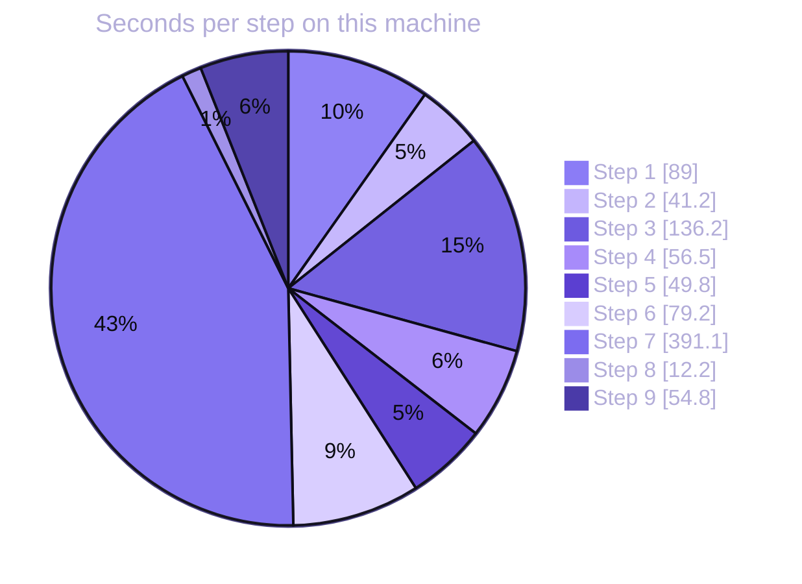

# Scoreboard

The first three tables come from one real agent run on one machine (run 1, answer-key prompts), recorded in [`demo-state/closeout-result.json`](../demo-state/closeout-result.json). The later sections come from runs made afterwards: [live runs with a model](#live-runs-with-a-model) (goal-based prompts, five repeats), [arms side by side](#arms-side-by-side), [crash tests side by side](#crash-tests-side-by-side) (macOS and a Linux container), [the dated integration runs](#integration-runs-no-model) and [the first scripted run](#the-first-scripted-run-no-llm). Each says what ran and what did not. The blocks below are generated by [`scripts/render_scoreboard.py`](../scripts/render_scoreboard.py). A test fails if they drift from the recorded outputs.

## Scoreboard

<!-- scoreboard:start -->
| Item | Result |
|---|---|
| Pulse and Grafx versions | okto-pulse 0.4.2, okto-pulse-core 0.4.2, okto-grafx 0.0.8 |
| Installed Pulse pins the installed Grafx | yes (`Requires-Dist: okto-grafx[accel]==0.0.8`) |
| Embedding model | sentence-transformers/all-MiniLM-L6-v2 (real model, not the stub) |
| Decisions committed in one consolidation | 12 of 12 |
| Cited file and line that exist | 12 of 12 |
| Recall: right decision chosen by the Recaller | 10 of 10 |
| Recall: right decision ranked first, similarity search | 10 of 10 |
| Recall: right decision ranked first, natural-language search | 10 of 10 |
| Recall: right decision ranked first, decision history | 0 of 10 (the tool returned no decisions for sentence-length topics) |
| Contradiction pairs: before, after supersede only, after explicit flag | 0, 0, 1 |
| Pulse flagged the reversal as a contradiction by itself | no |
| Supersedence chain length from the new decision | 1 (queried from the old decision: 0) |
| Global Discovery: expected convention found on the other board | 2 of 2; waits 5.5 s, 0.3 s |
| Kill A: uncommitted consolidation absent after restart | yes |
| Kill A: earlier decisions still present | yes (13 before, 13 after) |
| Kill A: board accepted a new commit | 19.4 s after the kill |
| Kill B: commits acknowledged before the kill | 20 |
| Kill B: acknowledged commits present after restart | 20 of 20 (0 missing) |
| Kill B: commits in flight at the kill, and how many survived | 2 in flight, 0 survived |
| Kill B: board accepted a new commit | 310.6 s after the kill (refusal while waiting: `lock_contention`; writer lock default TTL 300 s) |
| Health right after the Kill A restart, as returned | graph_state `at_risk`, overall_state `at_risk`, dead letters 0 |
| Health right after the Kill B restart, as returned | graph_state `healthy`, overall_state `healthy`, dead letters 0 |
| Node counts, decision board: Pulse vs direct read | 1 BoardMeta, 14 Decision, 2 Entity vs 1 BoardMeta, 14 Decision, 2 Entity; match: yes; edges 3 depends_on__Decision__Decision, 1 supersedes__Decision__Decision, 1 contradicts__Decision__Decision, 1 belongs_to__Entity__Entity |
| Node counts, crash test board: Pulse vs direct read | 1 BoardMeta, 21 Decision, 2 Entity vs 1 BoardMeta, 21 Decision, 2 Entity; match: yes; edges 1 belongs_to__Entity__Entity |
| Read-only open refused | no |
| Data files unchanged by the direct read | yes |
| `verify` on the stopped store | clean, 0 findings (14046 pages, 33 records, 108 index entries) |
| `verify` on the restored copy | clean, 0 findings (14046 pages, 33 records, 108 index entries) |
| Backup and restore on Linux aarch64 | backup ok, restore ok, counts match: yes, same database identity: yes |
| Backup on Darwin arm64 | refused by Grafx: `This platform has no supported atomic no-replace directory publication. [code=unsupported_operation retryable=False]` |
<!-- scoreboard:end -->

The decision board ends with 14 decisions: the 12 the Recorder committed, the 1 the Reviewer committed, and 1 synthetic `Write probe 1` commit made by the Kill A write check. The crash-test board holds the Kill B commits plus its own write-probe commits. The first Kill B attempt left a second crash-test board in the Pulse data home. The scoreboard uses the later run.

## Recall, question by question

The ten questions were fixed before the first run and were not changed after seeing results. The Recaller had no history and no file access. Scores are computed from the raw tool results in the transcript, not from what the agent said. The number in brackets is the similarity score of the top result.

<!-- recall:start -->
| # | Question | Expected decision | Similarity top 1 | Natural-language top 1 | History | Recaller chose |
|---:|---|---|---|---|---|---|
| 1 | How do clients send their login token on each request, and what prefix does the server expect? | `auth-header-scheme` | yes (0.44) | yes (0.44) | 0 results | right |
| 2 | How long does a login token stay valid before it expires? | `token-expiry` | yes (0.54) | yes (0.54) | 0 results | right |
| 3 | What does the app use to store user passwords safely? | `password-hashing` | yes (0.56) | yes (0.56) | 0 results | right |
| 4 | What does the body of an error response look like when a request fails? | `error-response-shape` | yes (0.56) | yes (0.56) | 0 results | right |
| 5 | Which query parameters control paging through a list of articles? | `pagination-parameters` | yes (0.52) | yes (0.52) | 0 results | right |
| 6 | How is the URL-friendly name of an article produced? | `slug-rules` | yes (0.49) | yes (0.49) | 0 results | right |
| 7 | Who is allowed to delete a comment? | `comment-ownership` | yes (0.67) | yes (0.67) | 0 results | right |
| 8 | What happens when a user marks an article as a favourite? | `favorites` | yes (0.61) | yes (0.61) | 0 results | right |
| 9 | Where does the app keep its settings and how are they read? | `settings-loading` | yes (0.55) | yes (0.55) | 0 results | right |
| 10 | How are the automated tests laid out? | `test-layout` | yes (0.36) | yes (0.36) | 0 results | right |
<!-- recall:end -->

The Recaller chose the similarity tool for all ten questions. The decision-history tool returned nothing for sentence-length topics.

## Time per step

Step 7 is dominated by the wait for the writer lease to expire after Kill B.

<!-- timings:start -->

<!-- timings:end -->

## Live runs with a model

Steps 3 to 5 with the goal-based prompts ([`docs/prompts/`](prompts/): no slugs, no override JSON, no edge ids), on fresh Pulse data homes, with `claude-opus-5-5` pinned in [`config/agent.json`](../config/agent.json) and passed with `--model` (the CLI accepted the name and reported it in every session). Four kinds of run, all in one folder with a manifest:

- **Smoke run**: `python run_demo.py --steps 3 4 5`, once.
- **Study `main`**: Recorder, Recaller and Reviewer with a model, five runs, each on its own data home. Recaller questions: dev, held-out and the model-authored set (43).
- **Study `reviewer-scripted-base`**: the board is built by the scripted client (the 12 recorded decisions, then the corpus), so the decision the Maintainer reverses is on it. Only the Reviewer calls a model. Five runs.
- **Study `resource-tool`**: Recorder and Reviewer with a model, five runs, after the harness was fixed to give them the tools that read MCP resources (see below). The Recaller is the scripted one here.

<!-- llmruns:start -->
Run `20261029T203549Z-4ffa2a8-dirty`. Model requested with `--model`: `claude-opus-5-5`; models the sessions reported: `claude-opus-5-5`. Claude Code 2.1.312, okto-pulse 0.4.2, okto-grafx 0.0.8, Python 3.12.13, Darwin arm64. 48 model sessions (smoke run, variance studies and the three arms), 0 of them reporting an error, $37.55 in total by the result events. Manifest: [`run-info.json`](../demo-state/llm-runs/20261029T203549Z-4ffa2a8-dirty/run-info.json).

**Variance study `main`: 5 runs, each on a fresh Pulse data home. Sessions with a model: recaller, recorder, reviewer. Generated 2026-10-29T21:25:05+00:00.**

| Run | Decisions the Recorder recorded | Citations that hold | Reference decisions covered (of 22) | Recaller, shared scorer: answerable right dev / held-out / model-authored | Recaller: unanswerable abstained | Reviewer: target on board, supersedes edges added, contradicts edges added, old node flagged superseded | Cost USD | Wall s |
|---:|---:|---:|---:|---|---|---|---:|---:|
| 1 | 16 | 16 | 9 | 9/10 / 11/11 / 12/12 | 3/3 / 3/3 / 4/4 | 0, 0, 0, 0 (reported recorded: 0) | 3.28 | 263 |
| 2 | 21 | 21 | 9 | 10/10 / 11/11 / 12/12 | 3/3 / 3/3 / 4/4 | 0, 0, 0, 0 (reported recorded: 0) | 3.47 | 273 |
| 3 | 17 | 17 | 7 | 9/10 / 11/11 / 12/12 | 3/3 / 3/3 / 4/4 | 0, 0, 0, 0 (reported recorded: 0) | 3.41 | 271 |
| 4 | 19 | 19 | 9 | 9/10 / 11/11 / 11/12 | 3/3 / 3/3 / 4/4 | 0, 0, 0, 0 (reported recorded: 0) | 3.27 | 240 |
| 5 | 19 | 19 | 10 | 9/10 / 11/11 / 11/12 | 3/3 / 3/3 / 4/4 | 0, 0, 0, 0 (reported recorded: 0) | 2.76 | 255 |

| Metric over the runs | n | Mean | Min | Max |
|---|---:|---:|---:|---:|
| Decisions recorded by the Recorder | 5 | 18.4 | 16 | 21 |
| Citations that hold (file, line and quote exist) | 5 | 18.4 | 16 | 21 |
| Reference decisions covered (of 22) | 5 | 8.8 | 7 | 10 |
| Recaller right, dev (of 10 answerable) | 5 | 9.2 | 9 | 10 |
| Recaller right, held-out (of 11) | 5 | 11.0 | 11 | 11 |
| Recaller right, model-authored (of 12) | 5 | 11.6 | 11 | 12 |
| Recaller fabricated an answer, all splits | 5 | 0.0 | 0 | 0 |
| Recaller strict choice right, all 43 questions (decision named is the expected one) | 5 | 41.0 | 41 | 41 |
| Answerable questions whose expected decision is on the board (of 33) | 5 | 32.0 | 32 | 32 |
| Pulse retrieval arm on the board after the Recorder: its own decisions plus the 20 scripted ones, dev right (of 10) | 5 | 7.0 | 7 | 7 |
| Pulse retrieval arm on the board after the Recorder: its own decisions plus the 20 scripted ones, held-out right (of 11) | 5 | 6.0 | 6 | 6 |
| Reviewer: reversal target on the board | 5 | 0.0 | 0 | 0 |
| Reviewer reported that it recorded the reversal | 5 | 0.0 | 0 | 0 |
| Reviewer: supersedes edges added | 5 | 0.0 | 0 | 0 |
| Reviewer: contradicts edges added | 5 | 0.0 | 0 | 0 |
| Reviewer: Pulse contradiction pairs afterwards | 5 | 0.0 | 0 | 0 |
| Reviewer: old decision flagged superseded (`superseded_by` set) | 5 | 0.0 | 0 | 0 |
| Recorder session cost USD | 5 | 1.32 | 1.23 | 1.38 |
| Recaller session cost USD | 5 | 1.11 | 0.57 | 1.33 |
| Reviewer session cost USD | 5 | 0.81 | 0.80 | 0.83 |
| Recorder wall seconds | 5 | 118 | 103 | 137 |
| Recaller wall seconds | 5 | 103 | 88 | 119 |
| Reviewer wall seconds | 5 | 39 | 33 | 52 |
| Recorder output tokens | 5 | 13392 | 12120 | 14336 |
| Recaller output tokens | 5 | 9734 | 7992 | 12815 |
| Reviewer output tokens | 5 | 2314 | 2188 | 2532 |
| Recorder turns | 5 | 43 | 38 | 47 |
| Recaller turns | 5 | 20 | 11 | 37 |

**Variance study `resource-tool`: 5 runs, each on a fresh Pulse data home. Sessions with a model: recorder, reviewer. Generated 2026-10-29T22:28:17+00:00.**

| Run | Decisions the Recorder recorded | Citations that hold | Reference decisions covered (of 22) | Recaller, shared scorer: answerable right dev / held-out / model-authored | Recaller: unanswerable abstained | Reviewer: target on board, supersedes edges added, contradicts edges added, old node flagged superseded | Cost USD | Wall s |
|---:|---:|---:|---:|---|---|---|---:|---:|
| 1 | 19 | 19 | 8 | not run with a model | not run with a model | 0, 0, 0, 0 (reported recorded: 0) | 2.26 | 216 |
| 2 | 17 | 17 | 8 | not run with a model | not run with a model | 0, 0, 0, 0 (reported recorded: 0) | 2.03 | 175 |
| 3 | 17 | 17 | 8 | not run with a model | not run with a model | 0, 0, 0, 0 (reported recorded: 0) | 2.14 | 182 |
| 4 | 18 | 18 | 8 | not run with a model | not run with a model | 0, 0, 0, 0 (reported recorded: 0) | 2.02 | 169 |
| 5 | 17 | 17 | 8 | not run with a model | not run with a model | 0, 0, 0, 0 (reported recorded: 0) | 2.04 | 187 |

| Metric over the runs | n | Mean | Min | Max |
|---|---:|---:|---:|---:|
| Decisions recorded by the Recorder | 5 | 17.6 | 17 | 19 |
| Citations that hold (file, line and quote exist) | 5 | 17.6 | 17 | 19 |
| Reference decisions covered (of 22) | 5 | 8.0 | 8 | 8 |
| Pulse retrieval arm on the board after the Recorder: its own decisions plus the 20 scripted ones, dev right (of 10) | 5 | 7.0 | 7 | 7 |
| Pulse retrieval arm on the board after the Recorder: its own decisions plus the 20 scripted ones, held-out right (of 11) | 5 | 6.0 | 6 | 6 |
| Reviewer: reversal target on the board | 5 | 0.0 | 0 | 0 |
| Reviewer reported that it recorded the reversal | 5 | 0.0 | 0 | 0 |
| Reviewer: supersedes edges added | 5 | 0.0 | 0 | 0 |
| Reviewer: contradicts edges added | 5 | 0.0 | 0 | 0 |
| Reviewer: Pulse contradiction pairs afterwards | 5 | 0.0 | 0 | 0 |
| Reviewer: old decision flagged superseded (`superseded_by` set) | 5 | 0.0 | 0 | 0 |
| Recorder session cost USD | 5 | 1.16 | 1.07 | 1.32 |
| Reviewer session cost USD | 5 | 0.94 | 0.89 | 0.95 |
| Recorder wall seconds | 5 | 143 | 121 | 181 |
| Reviewer wall seconds | 5 | 42 | 35 | 48 |
| Recorder output tokens | 5 | 14938 | 13954 | 16906 |
| Reviewer output tokens | 5 | 2474 | 2265 | 2627 |
| Recorder turns | 5 | 51 | 47 | 57 |

**Variance study `reviewer-scripted-base`: 5 runs, each on a fresh Pulse data home. Sessions with a model: reviewer. Generated 2026-10-29T21:50:18+00:00.**

| Run | Decisions the Recorder recorded | Citations that hold | Reference decisions covered (of 22) | Recaller, shared scorer: answerable right dev / held-out / model-authored | Recaller: unanswerable abstained | Reviewer: target on board, supersedes edges added, contradicts edges added, old node flagged superseded | Cost USD | Wall s |
|---:|---:|---:|---:|---|---|---|---:|---:|
| 1 | 12 (scripted) | 12 | 12 | not run with a model | not run with a model | 1, 1, 1, 0 (reported recorded: 1) | 0.65 | 88 |
| 2 | 12 (scripted) | 12 | 12 | not run with a model | not run with a model | 1, 1, 1, 0 (reported recorded: 1) | 0.41 | 56 |
| 3 | 12 (scripted) | 12 | 12 | not run with a model | not run with a model | 1, 1, 1, 0 (reported recorded: 1) | 0.56 | 77 |
| 4 | 12 (scripted) | 12 | 12 | not run with a model | not run with a model | 1, 1, 1, 0 (reported recorded: 1) | 0.79 | 106 |
| 5 | 12 (scripted) | 12 | 12 | not run with a model | not run with a model | 1, 1, 1, 1 (reported recorded: 1) | 0.55 | 77 |

| Metric over the runs | n | Mean | Min | Max |
|---|---:|---:|---:|---:|
| Pulse retrieval arm on the 32-decision corpus board, dev right (of 10) | 5 | 9.0 | 9 | 9 |
| Pulse retrieval arm on the 32-decision corpus board, held-out right (of 11) | 5 | 6.0 | 6 | 6 |
| Reviewer: reversal target on the board | 5 | 1.0 | 1 | 1 |
| Reviewer reported that it recorded the reversal | 5 | 1.0 | 1 | 1 |
| Reviewer: supersedes edges added | 5 | 1.0 | 1 | 1 |
| Reviewer: contradicts edges added | 5 | 1.0 | 1 | 1 |
| Reviewer: Pulse contradiction pairs afterwards | 5 | 1.0 | 1 | 1 |
| Reviewer: old decision flagged superseded (`superseded_by` set) | 5 | 0.2 | 0 | 1 |
| Reviewer session cost USD | 5 | 0.59 | 0.41 | 0.79 |
| Reviewer wall seconds | 5 | 81 | 56 | 106 |
| Reviewer output tokens | 5 | 6178 | 4587 | 8010 |

**Smoke run: `python run_demo.py --steps 3 4 5`, one run, goal-based prompts, dev and held-out questions only.**

| Item | Result |
|---|---|
| Recorder | 17 decisions, 17 with a citation that holds, 9 of 22 reference decisions covered |
| Recaller, shared scorer | dev 9 of 10 answerable, 3 of 3 abstentions; held-out 11 of 11, 3 of 3 abstentions |
| Recaller write probe | permission_denied: {"error": "Permission denied", "reason": "permission_missing", "required_permission": "kg.session.beg |
| Reviewer | decisions on the board 27 before, 27 after the Reviewer; contradicts edges 0 |
| Cost and time | Recorder $1.38, 130 s; Recaller $1.10, 96 s; Reviewer $0.80, 31 s |
<!-- llmruns:end -->

How to read this:

- **The Recorder cites real code every time.** All 197 decisions the Recorder wrote across the smoke run and the two Recorder studies (11 runs) cite a file, a line and a quote that exist. The number of decisions varies from 16 to 21.
- **Recall against the reference list is about 8 or 9 of 22, not 12.** The answer-key run covered 12 of 22 because the prompt named the topics. With a goal-based prompt the Recorder chose its own: 7 to 10 covered in the main study, 8 in every run of the resource-tool study. Six reference decisions were found in all 11 runs (pagination, article ownership, password hashing, JWT algorithm, token expiry, slug rules). 104 of the 197 nodes match no entry of the list, so the list is not a full inventory either. It was made by hand by the author of the repo and **has not been reviewed by a person**.
- **No Recorder ever wrote the decision the Maintainer then reverses.** The reversal target (the shape of HTTP error bodies) was not on the board in any of the 11 runs. The Reviewer then wrote nothing, 11 times of 11, and said why: the decision to replace is not in the graph. That is the right output for the prompt, and it is why the study `reviewer-scripted-base` exists.
- **The Reviewer without an answer key (scripted base).** In 5 of 5 runs the Reviewer recorded the new decision with a `supersedes` and a `contradicts` edge to the old one, and Pulse then reported one contradiction pair. It flagged the old node as superseded (`superseded_by` set) in 1 of 5 runs, the one where it overrode Pulse's `ADD` hint with `SUPERSEDE` at commit. In the other four the old node still reads as the current decision when asked from its own id, as in the answer-key run. Pulse's hint was `ADD` ("no semantic match") in the runs that asked for it.
- **The Recaller is stable on this board.** Over five runs it chose the expected decision for the same questions in each: 41 of 43 by the strict count (the decision it names is the expected one), and it abstained on all 10 unanswerable questions in every run. The two misses are the same in every run. `d9` asks about the tag tables, and the expected decision (`tag-handling`) is one that no Recorder wrote. `m6` was answered from a decision the Recorder wrote itself, whose id the corpus mapping cannot name. The shared scorer then falls back on a keyword in the answer text, and that keyword (`next to`, written by the question-writing model) matches the wording of some runs and not of others. That is why the shared-scorer counts move by one (dev 9 or 10, model-authored 11 or 12) while the strict count does not. It is a limit of the scorer on a board the Recorder wrote itself, not a change in what the Recaller did.
- **Cost and time.** About $3.2 and 4.3 minutes for a full steps 3 to 5 run (mean of the five runs of the main study: $3.24, 260 s), the same as the pilot reference. The total for every model session in this section and in the arms is in the first paragraph of the block above, and in the manifest. Wall times were not taken on an idle machine (see the manifest notes).
- **The documented write format was not readable at first.** Both prompts send the agent to the Pulse resource `okto-pulse://workflows/kg`. In the smoke run and the main study every Recorder and Reviewer reported that it had no tool to read an MCP resource, and worked the format out by trial and error (the Reviewer logged three rejected edge calls). `run_agent.py --mcp-resources` now adds the two Claude Code tools that read resources (probe: without them the session refuses, with them it returns the document). The resource-tool study ran with them. The Recorder's numbers did not change in any way a five-run study can resolve (8.0 of 22 against 8.8 of 22, 17.6 nodes against 18.4), and the Reviewer still found no target.

## Arms side by side

Does the graph help? This table puts every way of answering the same questions next to each other, scored by one scorer ([`scripts/score_arms.py`](../scripts/score_arms.py)). The corpus has 32 decisions, ten of them with a reason that exists only in the graph, near-duplicate families such as six token-related decisions, and unanswerable questions that must be met with an abstention. The questions and their word overlap with the decisions are in [QUESTIONS.md](QUESTIONS.md). The graph arm reads the board that [`scripts/build_corpus.py`](../scripts/build_corpus.py) builds; every model run used `claude-opus-5-5`.

<!-- arms:start -->
**Questions answered right (answerable questions only)**

| Arm | Runs | Right: dev | Right: held-out | Right: model-authored | Right: legacy |
|---|---:|---|---|---|---|
| Lexical baseline: tf-idf, no model | 1 | 4 of 10 | 3 of 11 | 11 of 12 | 4 of 10 |
| Pulse and Grafx retrieval, scripted client, no LLM | 1 | 9 of 10 | 6 of 11 | 11 of 12 | 7 of 10 |
| LLM agent with the graph (read-only Recaller) | 5 | 10.0 of 10 (10 to 10, n=5) | 11.0 of 11 (11 to 11, n=5) | 11.0 of 12 (11 to 11, n=5) | not asked |
| LLM agent with the code only | 5 | 5.0 of 10 (5 to 5, n=5) | 5.0 of 11 (5 to 5, n=5) | 3.0 of 12 (3 to 3, n=5) | not asked |
| LLM agent with the code and plain text notes | 5 | 10.0 of 10 (10 to 10, n=5) | 11.0 of 11 (11 to 11, n=5) | 12.0 of 12 (12 to 12, n=5) | not asked |

**Everything else the scorer measures**

| Arm | Abstained on unanswerable | Fabricated an answer | Graph-only reason right | Near-duplicate right | Conflict tasks: decision found | Conflict tasks: stance adapt or stop, decision found or not | Conflict tasks: decision found and stance adapt or stop | Cost and time |
|---|---|---|---|---|---|---|---|---|
| Lexical baseline: tf-idf, no model | 9 of 10 | 1 of 10 | 10 of 16 | 16 of 30 | 0 of 2 | no stance (not an agent) | no stance (not an agent) | no model |
| Pulse and Grafx retrieval, scripted client, no LLM | 7 of 10 | 3 of 10 | 13 of 16 | 23 of 30 | 2 of 2 | no stance (not an agent) | no stance (not an agent) | no model |
| LLM agent with the graph (read-only Recaller) | 10.0 of 10 (10 to 10, n=5) | 0.0 of 10 (0 to 0, n=5) | 16.0 of 16 (16 to 16, n=5) | 29.0 of 30 (29 to 29, n=5) | 2.0 of 2 (2 to 2, n=5) | 2.0 of 2 (2 to 2, n=5) | 2.0 of 2 (2 to 2, n=5) | $0.46 and 65 s per run (n=5, cost 0.32 to 0.88) |
| LLM agent with the code only | 6.0 of 10 (6 to 6, n=5) | 4.0 of 10 (4 to 4, n=5) | 0.0 of 16 (0 to 0, n=5) | 13.0 of 30 (13 to 13, n=5) | 0.0 of 2 (0 to 0, n=5) | 1.6 of 2 (1 to 2, n=5) | 0.0 of 2 (0 to 0, n=5) | $0.31 and 65 s per run (n=5, cost 0.30 to 0.32) |
| LLM agent with the code and plain text notes | 10.0 of 10 (10 to 10, n=5) | 0.0 of 10 (0 to 0, n=5) | 16.0 of 16 (16 to 16, n=5) | 30.0 of 30 (30 to 30, n=5) | 2.0 of 2 (2 to 2, n=5) | 2.0 of 2 (2 to 2, n=5) | 2.0 of 2 (2 to 2, n=5) | $0.15 and 39 s per run (n=5, cost 0.14 to 0.17) |

Corpus: 32 decisions (12 recorded, 10 code-derived, 10 graph-only with an invented reason). Questions: dev 13, held-out 14, model-authored 16 (written by claude-haiku-5-5, scored separately), legacy 10. One scorer for every arm. Abstention threshold of the lexical and Pulse arms: chosen on dev, applied to the rest. The LLM arms were asked dev, held-out and model-authored, not legacy.
For comparison, the lexical baseline on the original ten questions against only the 12 recorded decisions: 7 of 10 (misses l2, l4, l9).
Each LLM arm was run 5, 5, 5 times (memory, no-memory, code-notes). With several runs a cell is the mean count, then the lowest and highest count and n. Nothing is pooled across arms.
<!-- arms:end -->

What the table shows:

- **The graph and plain notes did not differ.** On the 43 questions and the two conflict proposals, an agent with the graph and an agent with a text file of the same 32 decisions scored the same on every split except one question (model-authored: 11 of 12 against 12 of 12), in all five runs of each. Both found the decision and stopped or adapted on both conflict proposals in every run. The notes arm was cheaper ($0.15 and 39 s per run, against $0.46 and 65 s for the graph).
- **Both beat the agent with only the code, where the knowledge is in the memory and nowhere else.** The code-only agent found 0 of 16 graph-only reasons (they are invented and written only in the graph and in the notes, so this is by construction), cited the decision on 0 of 2 conflict proposals, and still chose `adapt` on most of them from what it saw in the code. The gap is a measure of what the corpus holds outside the code, not of how well Pulse retrieves it.
- **The code-only agent "fabricated" 4 answers, all on the model-authored unanswerable questions.** It answered "No, the app has no rate limiting" or "no WebSocket routes" from the absence of a feature in the code. The scorer counts any answer to an unanswerable question as fabricated, so these are counted as such. Whether a negative read from the code is a fabrication is a question about the scorer, not about the model. The question sets dev and held-out, whose unanswerable questions ask for things like a cloud region, got abstentions (6 of 6).
- **Pulse's search alone is far from the agent.** The scripted retrieval got 9 of 10, 6 of 11 and 11 of 12 on dev, held-out and model-authored. The agent with the graph got 10, 11 and 11 by calling the read tools itself. The agent never fabricated an answer; the scripted search fabricated one on each split.
- **The model-authored questions are easy for a plain match.** The lexical baseline got 11 of 12 on them, against 4 of 10 and 3 of 11 on dev and held-out. A different model wrote them from the decision texts, and they reuse the decisions' own words (`bcrypt`, `fancyhash`, `PostgreSQL`, `LR-77`). They are scored separately and are not the harder test.
- **What this does not show.** One model. A corpus of 32 notes that fits in one file read, where a plain text file is a strong control. Reasons that are invented. Two conflict proposals. Five runs per arm on one board, so the identical scores say the model is stable on these questions, not that the arm is always right. No larger corpus, no real team, no time saved or mistakes avoided. The questions of dev and held-out were written by an assistant model and a person has not reviewed them.

## Crash tests side by side

Kill A (SIGKILL with a consolidation open) and Kill B (SIGKILL during a commit burst) in every recorded run. The runs differ in kind, so nothing is averaged. The Linux run is a container on a Docker Desktop VM on the same Mac, not a bare-metal Linux host.

<!-- crash:start -->
| Run | Kill A: draft absent after restart | Kill A: earlier decisions still there | Kill A: first write accepted | Kill B: acknowledged commits present after restart | Kill B: in flight at the kill, survived | Kill B: writes accepted again | Kill B: refusal while waiting |
|---|---|---|---|---|---|---|---|
| Agent run 1, macOS arm64 (2026-10-29) | yes | yes (13 before, 13 after) | 19.4 s after the kill | 20 of 20 | 2 in flight, 0 survived | 310.6 s after the kill | `lock_contention` |
| Scripted run, macOS arm64 | yes | yes (3 before, 3 after) | 21.6 s after the kill | 24 of 24 | 1 in flight, 1 survived | 309.3 s after the kill | `lock_contention` |
| Integration run, macOS arm64, `integration-20261029T210523Z-4ffa2a8-dirty` | yes | yes (3 before, 3 after) | 20.4 s after the kill | 16 of 16 | 1 in flight, 0 survived | 81.4 s after the kill | none |
| Linux container run, aarch64 (Docker Desktop VM), `linux-crash-20261029T205018Z-4ffa2a8-dirty` | yes | yes (3 before, 3 after) | 41.6 s after the kill | 14 of 14 | 1 in flight, 0 survived | 305.8 s after the kill | `lock_contention` |
<!-- crash:end -->

No acknowledged commit was lost in any of the four runs (20, 24, 16 and 14 acknowledged commits in the four Kill B runs, 74 in all). The wait for the writer lock after Kill B was about 300 s in three of the four runs and absent in the fourth, the macOS integration run, where the first write after the restart was accepted at once. So "a killed server blocks writes for about five minutes" is what happened in three of four, not always. Commits that were in flight at the kill and never acknowledged: 5 in all, 1 of them present after the restart, which is what the guarantee allows.

## Integration runs (no model)

<!-- integration:start -->
| Run | Where | Assertions | Step 9 | Started (UTC) |
|---|---|---|---|---|
| `20261029T210523Z-4ffa2a8-dirty` | macOS host, step 9 in a Linux container: Darwin arm64, Python 3.12.13 | 48 of 48 passed, skipped: none | ran and passed | 2026-10-29T21:05:23Z |
| `20261029T205018Z-4ffa2a8-dirty` | Linux container: Linux aarch64, Python 3.12.16 | 43 of 43 passed, skipped: step 9 (backup and restore) did not run | not part of this run | 2026-10-29T20:50:18Z |
<!-- integration:end -->

The macOS run is [`run_integration.py --require-step9`](../scripts/run_integration.py) with a temporary HOME and `DOCKER_CONFIG` set: scripted agents for steps 3 to 5, then steps 6 to 9 (step 9 in a Linux container), then 48 assertions. It also wrote the Pulse retrieval arm file in `demo-state/arms/`. The Linux run is [`run_linux_crash.py`](../scripts/run_linux_crash.py): the same scripts in a container built from `requirements.txt` and `constraints.txt` (CPU torch, `python:3.12-slim` pinned by digest), up to and including step 8. Step 9 is not part of it. Both have a manifest with SHA-256 per file and a step log folder.

## The first scripted run (no LLM)

A scripted client made the Pulse calls of steps 1 to 8 on a fresh data home, in [`scripts/run_integration.py`](../scripts/run_integration.py). Step 9 was not run in that run (Docker was not running); [the later integration run](#integration-runs-no-model) ran it. The files are in [`demo-state/scripted-run/`](../demo-state/scripted-run/), with the machine, versions and commit in `run-info.json`. These rows show what Pulse and Grafx do with a fixed call sequence. They do not show what an agent would choose to do.

<!-- scripted:start -->
| Item | Result |
|---|---|
| Spec gate, refusal | `spec_validation_gate_not_ready`: decision_verification_plan_incomplete: dec_adb60508: decision_verification_required |
| Spec gate, pass | spec status `validated` after the plan was added (edition 2) |
| Decision nodes of the approved spec, before the closeout | {'working': 10}; the Recaller found 0 of 10 by similarity |
| Closeout consolidation | refused first without an Alternative edge (`kg_node_connectivity_violation`), then committed: 20 nodes added, 10 working nodes superseded; the Recaller then found 10 of 10 |
| Role RECALLER (Reporter) | 10 of 10 actions outside the preset refused (5 by permission, 5 by session ownership); 2 of 2 own actions succeeded |
| Role RECORDER (Spec) | 4 of 4 actions outside the preset refused (4 by permission, 0 by session ownership); 4 of 4 own actions succeeded |
| Role REVIEWER (Validator) | 5 of 5 actions outside the preset refused (5 by permission, 0 by session ownership); 2 of 2 own actions succeeded |
| Kill A, resume with a new session | draft absent after restart: yes; after replaying six decisions, each exists exactly once: yes (hints {'killa-base-1': 'UPDATE', 'killa-base-2': 'UPDATE', 'killa-base-3': 'UPDATE', 'killa-draft-1': 'ADD', 'killa-draft-2': 'ADD', 'killa-draft-3': 'ADD'}) |
| Kill B, retry of the in-flight commits | 1 retried, 1 of them already present; no slug exists twice: yes; superseded by another decision during the retry: 0 |
| Decision board during step 7 | 23 decisions before, 23 after, unchanged: yes |
<!-- scripted:end -->
