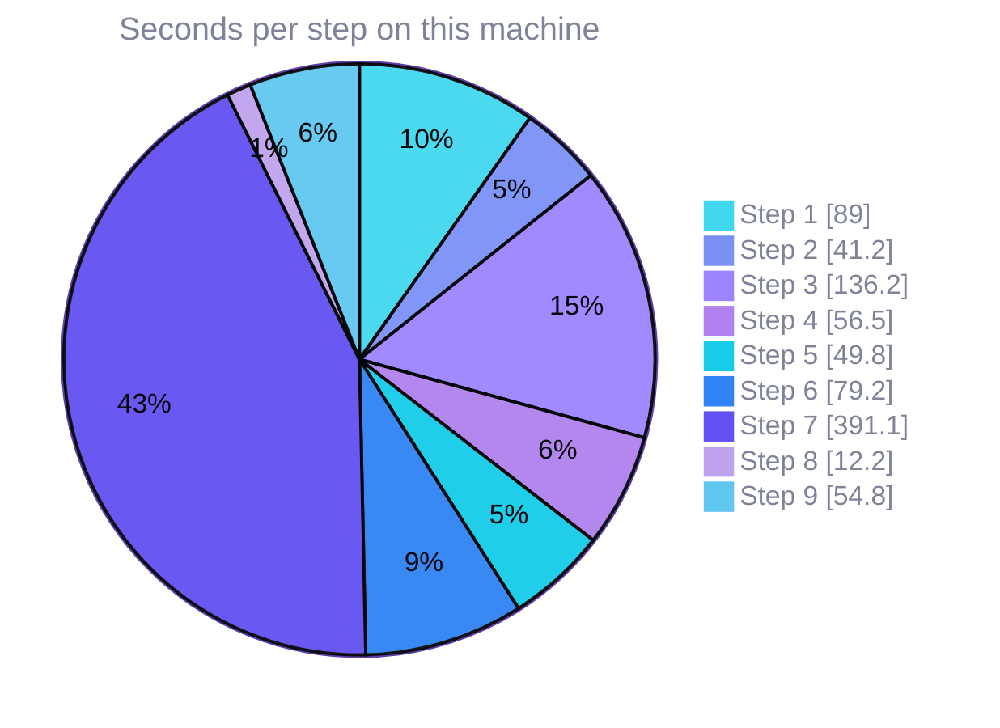

# Scoreboard

Every number comes from one real run on one machine, recorded in [`demo-state/closeout-result.json`](../demo-state/closeout-result.json). The blocks below are generated by [`scripts/render_scoreboard.py`](../scripts/render_scoreboard.py). A test fails if they drift from the recorded outputs.

## Scoreboard

<!-- scoreboard:start -->
| Item | Result |
|---|---|
| Pulse and Grafx versions | okto-pulse 0.4.2, okto-pulse-core 0.4.2, okto-grafx 0.0.8 |
| Installed Pulse pins the installed Grafx | yes (`Requires-Dist: okto-grafx[accel]==0.0.8`) |
| Embedding model | sentence-transformers/all-MiniLM-L6-v2 (real model, not the stub) |
| Decisions committed in one consolidation | 12 of 12 |
| Cited file and line that exist | 12 of 12 |
| Recall: right decision chosen by the Recaller | 10 of 10 |
| Recall: right decision ranked first, similarity search | 10 of 10 |
| Recall: right decision ranked first, natural-language search | 10 of 10 |
| Recall: right decision ranked first, decision history | 0 of 10 (the tool returned no decisions for sentence-length topics) |
| Contradiction pairs: before, after supersede only, after explicit flag | 0, 0, 1 |
| Pulse flagged the reversal as a contradiction by itself | no |
| Supersedence chain length from the new decision | 1 (queried from the old decision: 0) |
| Global Discovery: expected convention found on the other board | 2 of 2; waits 5.5 s, 0.3 s |
| Kill A: uncommitted consolidation absent after restart | yes |
| Kill A: earlier decisions still present | yes (13 before, 13 after) |
| Kill A: board accepted a new commit | 19.4 s after the kill |
| Kill B: commits acknowledged before the kill | 20 |
| Kill B: acknowledged commits present after restart | 20 of 20 (0 missing) |
| Kill B: commits in flight at the kill, and how many survived | 2 in flight, 0 survived |
| Kill B: board accepted a new commit | 310.6 s after the kill (refusal while waiting: `lock_contention`; writer lock default TTL 300 s) |
| Health right after the Kill A restart, as returned | graph_state `at_risk`, overall_state `at_risk`, dead letters 0 |
| Health right after the Kill B restart, as returned | graph_state `healthy`, overall_state `healthy`, dead letters 0 |
| Node counts, decision board: Pulse vs direct read | 1 BoardMeta, 14 Decision, 2 Entity vs 1 BoardMeta, 14 Decision, 2 Entity; match: yes; edges 3 depends_on__Decision__Decision, 1 supersedes__Decision__Decision, 1 contradicts__Decision__Decision, 1 belongs_to__Entity__Entity |
| Node counts, crash test board: Pulse vs direct read | 1 BoardMeta, 21 Decision, 2 Entity vs 1 BoardMeta, 21 Decision, 2 Entity; match: yes; edges 1 belongs_to__Entity__Entity |
| Read-only open refused | no |
| Data files unchanged by the direct read | yes |
| `verify` on the stopped store | clean, 0 findings (14046 pages, 33 records, 108 index entries) |
| `verify` on the restored copy | clean, 0 findings (14046 pages, 33 records, 108 index entries) |
| Backup and restore on Linux aarch64 | backup ok, restore ok, counts match: yes, same database identity: yes |
| Backup on Darwin arm64 | refused by Grafx: `This platform has no supported atomic no-replace directory publication. [code=unsupported_operation retryable=False]` |
<!-- scoreboard:end -->

The decision board ends with 14 decisions: the 12 the Recorder committed, the 1 the Reviewer committed, and 1 synthetic `Write probe 1` commit made by the Kill A write check. The crash-test board holds the Kill B commits plus its own write-probe commits. The first Kill B attempt left a second crash-test board in the Pulse data home. The scoreboard uses the later run.

## Recall, question by question

The ten questions were fixed before the first run and were not changed after seeing results. The Recaller had no history and no file access. Scores are computed from the raw tool results in the transcript, not from what the agent said. The number in brackets is the similarity score of the top result.

<!-- recall:start -->
| # | Question | Expected decision | Similarity top 1 | Natural-language top 1 | History | Recaller chose |
|---:|---|---|---|---|---|---|
| 1 | How do clients send their login token on each request, and what prefix does the server expect? | `auth-header-scheme` | yes (0.44) | yes (0.44) | 0 results | right |
| 2 | How long does a login token stay valid before it expires? | `token-expiry` | yes (0.54) | yes (0.54) | 0 results | right |
| 3 | What does the app use to store user passwords safely? | `password-hashing` | yes (0.56) | yes (0.56) | 0 results | right |
| 4 | What does the body of an error response look like when a request fails? | `error-response-shape` | yes (0.56) | yes (0.56) | 0 results | right |
| 5 | Which query parameters control paging through a list of articles? | `pagination-parameters` | yes (0.52) | yes (0.52) | 0 results | right |
| 6 | How is the URL-friendly name of an article produced? | `slug-rules` | yes (0.49) | yes (0.49) | 0 results | right |
| 7 | Who is allowed to delete a comment? | `comment-ownership` | yes (0.67) | yes (0.67) | 0 results | right |
| 8 | What happens when a user marks an article as a favourite? | `favorites` | yes (0.61) | yes (0.61) | 0 results | right |
| 9 | Where does the app keep its settings and how are they read? | `settings-loading` | yes (0.55) | yes (0.55) | 0 results | right |
| 10 | How are the automated tests laid out? | `test-layout` | yes (0.36) | yes (0.36) | 0 results | right |
<!-- recall:end -->

The Recaller chose the similarity tool for all ten questions. The decision-history tool returned nothing for sentence-length topics.

## Time per step

Step 7 is dominated by the wait for the writer lease to expire after Kill B.

<!-- timings:start -->

<!-- timings:end -->
