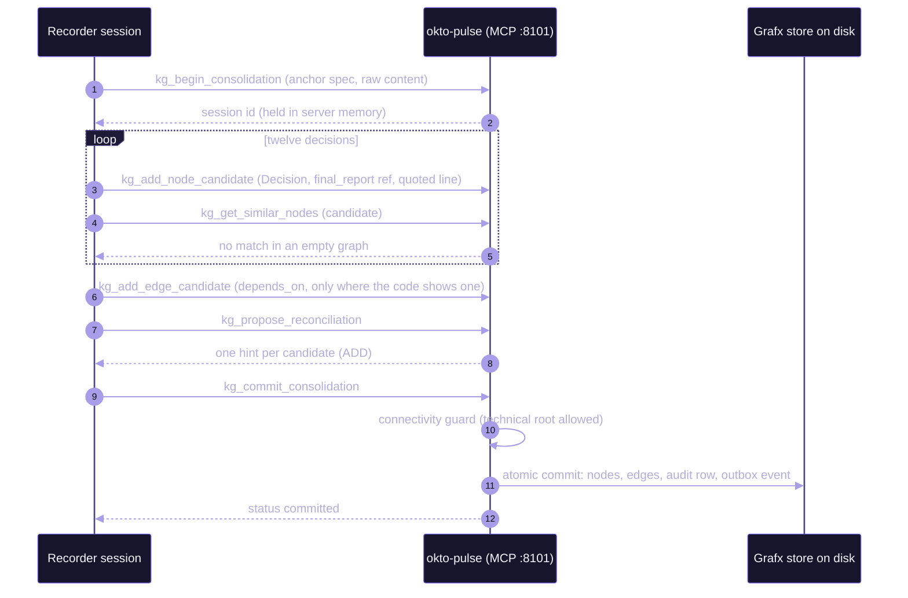
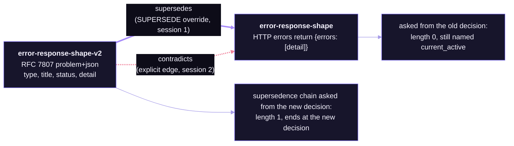
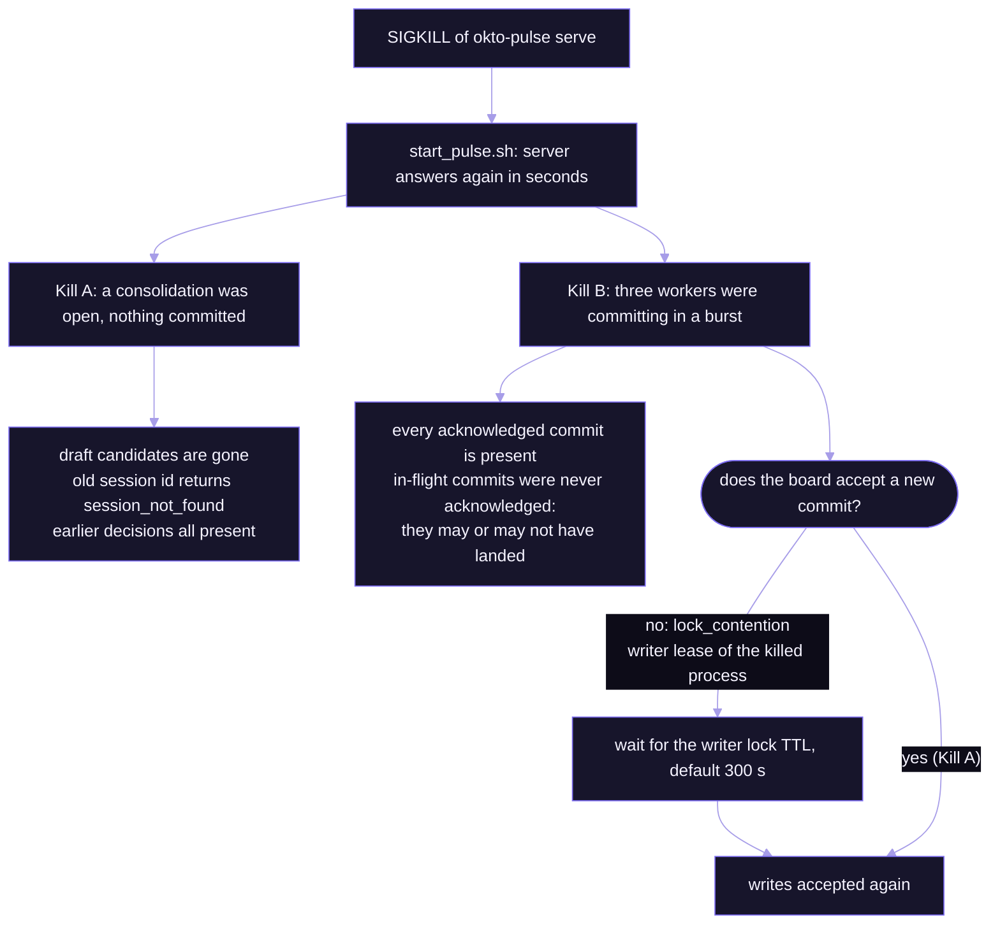
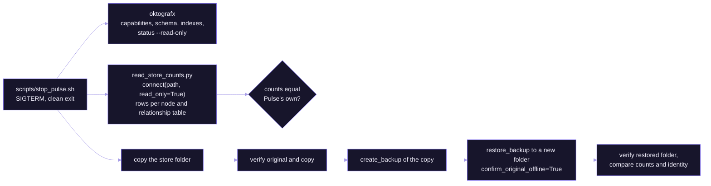

# How it works

Details behind the README. The numbers are in [SCOREBOARD.md](SCOREBOARD.md) and the surprises are in [FINDINGS.md](FINDINGS.md).

The codebase is a trimmed copy of [`nsidnev/fastapi-realworld-example-app`](https://github.com/nsidnev/fastapi-realworld-example-app) in [`app/`](../app/). It is never run, so Postgres is not needed. Agents only read it.

## The cast

| Who | Does | Pulse identity |
|---|---|---|
| **Recorder** (session) | Reads the code and records twelve decisions in one consolidation | Preset `Spec`, own key |
| **Recaller** (session) | Starts with no history and answers ten questions from the graph | Preset `Reporter`, read only, own key |
| **Reviewer** (session) | Records a reversed decision, reads contradictions and the supersedence chain | Preset `Validator`, own key |
| **Maintainer** (terminal) | Runs the scripts, reverses a decision, kills and stops the server | Preset `Full Control`, used by scripts only |

Each session is a separate headless `claude -p` process with its own MCP config, `--strict-mcp-config`, and no saved history. Keys are passed through environment variables and kept in `agents/.keys.local`, which git ignores. A scanner checks the repo for keys before every commit.

The sessions get their powers from Pulse's own permission presets. The Recaller really is read only: at the end of its run it tries to open a write session and Pulse refuses with `permission_denied` for `kg.session.begin`.

## How a decision gets in

One consolidation holds all twelve decisions. The session lives in server memory until the commit, which is why a kill before the commit discards it.



A cognitive `Decision` has to be anchored to something. The connectivity guard refused refs of the form `spec:<id>:decision:<slug>` with `kg_node_connectivity_violation`, because the required `belongs_to` edge is reserved for Pulse's deterministic worker. The documented technical root is a source ref that starts with `final_report:`. The demo uses `final_report:<spec-id>:decision:<slug>`. The anchor spec stays in draft.

## What a recorded decision looks like

This is the password decision as read back from the graph ([`decisions-from-graph.json`](../demo-state/step3/decisions-from-graph.json)):

```json
{
  "title": "Passwords are hashed with bcrypt through passlib CryptContext, with a per-user bcrypt salt prepended to the password.",
  "content": "security.py builds a passlib CryptContext with schemes [\"bcrypt\"] and deprecated=\"auto\". ... \nSource: app/app/services/security.py:4",
  "ref": "final_report:<spec-id>:decision:password-hashing",
  "quote": "pwd_context = CryptContext(schemes=[\"bcrypt\"], deprecated=\"auto\")",
  "layer": "canonical"
}
```

[`scripts/check_citations.py`](../scripts/check_citations.py) opens every cited file, checks that the line exists, and checks that the quote is on it.

**The twelve decisions:** auth header scheme, token expiry, password hashing, error response shape, pagination parameters, slug rules, comment ownership, favorites, tag handling, database access layer, settings loading, test layout.

## The reversal

The Maintainer writes a note that reverses the error response shape. The Reviewer records the new decision with a `SUPERSEDE` override, checks whether Pulse flagged a contradiction, and then adds one explicitly in a second session.



Pulse did not flag the reversal as a contradiction by itself. The pair showed up only after the explicit edge. The numbers are in the scoreboard.

## Architecture

<p align="center">
  
</p>

The sessions talk to Pulse over MCP on port 8101. Pulse serves the web UI and API on 8100. SQLite holds boards, agents, specs and the consolidation queue. Open consolidation sessions live in server memory. The stores sit under the Pulse data home:

```text
.work/pulse-home/                      throwaway data home (DATA_DIR), never ~/.okto-pulse
├── data/pulse.db                      SQLite: boards, agents, specs, queue
├── boards/<board-id>/
│   ├── graph_backend_binding.json     names the generation
│   └── grafx/generation-1/            the Grafx store
│       ├── catalog.dat  heap.dat  grafx.meta
│       ├── commits.dat  commits.dir   commit history files
│       ├── control/                   locks, writer lease, commit state
│       ├── index/                     secondary and vector indexes
│       └── wal/                       write-ahead log
└── global/grafx/generation-1/         Global Discovery store
```

## What the crash tests do



## What the direct read and the backup do

Pulse is stopped first. Nothing here writes into a Pulse-owned store.



The read-only reader is short. This is the core of [`scripts/read_store_counts.py`](../scripts/read_store_counts.py):

```python
from okto_grafx import connect

with connect(store_path, read_only=True) as db:          # refusals are recorded, never worked around
    for table in db.catalog.catalog.tables():
        if is_node_table(table):
            n = db.execute(f"MATCH (n:{table.name}) RETURN count(*)").rows[0][0]
        else:
            n = db.execute(f"MATCH ()-[r:{table.name}]->() RETURN count(*)").rows[0][0]
```

## Repository structure


```text
app/                  fork of fastapi-realworld-example-app (read only, MIT, see app/FORK_NOTES.md)
agents/               CLAUDE.md per role, MCP config examples with key placeholders
scripts/              start, stop, kill, step scripts, reader, checkers, scanner
  step03_recorder.py ... step09_backup_restore.py   one script per step
  check_citations.py  read_store_counts.py  run_agent.py  build_closeout.py  render_scoreboard.py
demo-state/           every recorded output: step1/ .. step9/, notes/, screenshots/, closeout-result.json
docs/                 walkthrough, VERIFIED.md, prompts/, hero and architecture SVGs, kickoff prompt
tests/                tests that read the recorded outputs
.github/workflows/    validate.yml
run_demo.py           replay any steps: --steps, --start, --dry-run
requirements.txt      pinned okto-pulse and okto-grafx
```

## Prerequisites


| | Needed | Notes |
|---|---|---|
| 1 | Mac or Linux | Step 7 uses SIGKILL. Windows is not covered. |
| 2 | Python 3.11, 3.12 or 3.13 | Grafx does not list 3.14. The run used 3.12. |
| 3 | [Claude Code](https://docs.claude.com/en/docs/claude-code), installed and logged in | No other model key is needed. Pulse and Grafx use no LLM of their own. |
| 4 | Network to PyPI, GitHub, Hugging Face | Pulse downloads the embedding model on first start and falls back to a stub if that fails. Step 1 stops if it sees a stub. |
| 5 | About 1.5 GiB of disk | The run measured 1.42 GiB by free-space change and 1.3 GB for the virtual environment. |
| 6 | Ports 8100 and 8101 free | |
| 7 | Docker, on macOS only | Grafx 0.0.8 refuses backups on macOS, so step 9 repeats the procedure in a `python:3.12-slim` container. Also needed for `scripts/run_linux_crash.py`. |
| 8 | Model usage | A full run starts three agent sessions: Recorder, Recaller and Reviewer, about $3 and 4 minutes with `claude-opus-5-5` (mean of five recorded runs). `scripts/run_n.py` and `scripts/run_arms.py` start more. |
